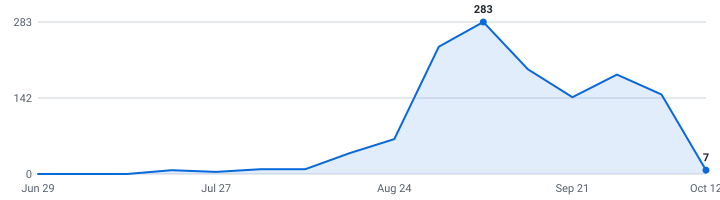

# 🔧 Summer 2027 Mechanical Engineering Internships

**A self-updating engine that tracks mechanical engineering internships so you don't have to.**

&nbsp;&nbsp;&nbsp;

### 1125 open roles (549 listed below) · 154 new this week

4,982 employers tracked · data as of Oct 31, 2026 at 16:38 UTC

_816 have a cycle the employer stated · 309 are recent postings whose cycle isn't stated (listed separately, never mixed in)._

**[🖥️ Live dashboard](https://tracker05.github.io/mechanical-engineering-internships/)** · **[📡 RSS](https://tracker05.github.io/mechanical-engineering-internships/feed.xml)** · **[⚙️ JSON API](https://tracker05.github.io/mechanical-engineering-internships/api/jobs.json)** · **[✉️ Email alerts](https://tracker05.github.io/mechanical-engineering-internships/#subscribe)**

> [!TIP]
> **⭐ Star this repo** to save it and get updates when new roles are added.

Instead of refreshing a dozen career pages by hand, it reads company hiring feeds directly and keeps one live list — newest roles on top, refreshed automatically throughout the day.

**🔔 New roles in your inbox:** [subscribe by email](https://tracker05.github.io/mechanical-engineering-internships/#subscribe) - one email a day, only when new internships actually appeared, unsubscribe from any email in two clicks. (Prefer RSS-to-email? [Feedrabbit works too](https://feedrabbit.com/subscriptions/new?url=https%3A%2F%2Fraw.githubusercontent.com%2FTracker05%2Fmechanical-engineering-internships%2Fmain%2Fdocs%2Ffeed.xml).)

---

## What this is

This is an engine, not a hand-kept list. It polls company career feeds every 30 minutes, finds the internships, removes duplicates, and rebuilds this page on its own.

Every link comes straight from the source — so it's real and current, not a stale list someone forgot to update. Speed matters.

## What makes this different

| | |
|---|---|
| 📅 **[Drop Radar](#drop-radar)** | A forecast of **what's coming**. Each marquee company's typical opening window, replaced by the real drop date the moment the engine catches it live. Windows are estimates and labelled as such; only dates the engine saw itself are marked verified. |
| 🛂 **Visa intel, computed** | 🇺🇸 / 🛂 flags detected automatically from every job description, plus ✓ for employers with a real H-1B track record (USCIS data, FY2022-23 — a history, not a promise). The big lists crowdsource this by hand; here it's code. Most postings say nothing either way, and those show as unknown rather than guessed. |
| 📆 **A real date on nearly every role** | Taken from the job portal itself wherever the portal states one, so newest-first actually means newest. The exact coverage figure is printed at the bottom of this page every run. |
| 🧰 **Skill tags + pay, extracted** | Every posting's text is scanned for the stack it wants (Python, C++, PyTorch, …) and the pay it states — searchable on the [dashboard](https://tracker05.github.io/mechanical-engineering-internships/), and included in the CSV and API. |
| 🔔 **Alerts your way** | [Email digests](https://tracker05.github.io/mechanical-engineering-internships/#subscribe) or [RSS](https://tracker05.github.io/mechanical-engineering-internships/feed.xml) — point any reader, or a Slack/Discord RSS integration, at it. Plus a [live dashboard](https://tracker05.github.io/mechanical-engineering-internships/) with search, filters, and a saved-roles list that never leaves your browser. |
| ⚙️ **An engine, not a spreadsheet** | 5,295 job-board endpoints (4,982 distinct employers; some run more than one board) polled every 30 minutes across 12 ATS platforms. Full source and tests in this repo. |

## Scope

| | |
|---|---|
| **Roles** | Mechanical Design, Manufacturing, Thermal/Fluids, Automotive, Aerospace, Robotics & Controls, Structures & Materials, Energy, Test & Quality (and closely related technical internships) |
| **Region** | United States |
| **Cycles** | Summer 2027 and Fall 2026 |

## About

I'm an international student studying in the United States, so I built this for the search I'm doing myself. The list is US roles only for now — that's where I'm searching.

Use it to spot roles early and apply before they fill up. Being first genuinely helps.

## Where this is going

I'm building this in the open and adding to it as it grows.

**Recently shipped:** email alerts · the Drop Radar · auto-detected sponsorship flags · the live dashboard

**Next up:** personalized alerts (pick your categories) · per-company hiring pages · a ghost-posting detector

If it helps you, a star means a lot and tells me to keep going.

## How to use

<b>Reading the table — flags, dates, and the cycle split</b> (click to expand)

- Roles are grouped by cycle below - **newest posting on top, oldest at the bottom.**
- A cycle section holds only roles whose **employer stated that cycle** - in the title, or in the posting's own text. Postings that name no cycle anywhere are in *Recently posted — cycle not stated* further down, with **no cycle guessed for them**. Same quality bar, different amount of evidence.
- The **Posted** column is the date the company published the role.
- **_(3 openings)_ after a role title** = the employer has that many separate live requisitions for the same job, in the same place, for the same cycle. They're all real and each takes its own application, so they're linked individually (**Apply**, then **#2**, **#3**) instead of repeating the row. Counts still count requisitions, and the CSV export is never grouped.
- **🆁 after a company name** = **this role is remote** — the posting's own location or title says so. It marks the role on that row, not the whole company.
- **Flags after a role title:** 🇺🇸 = requires U.S. citizenship or a security clearance · 🛂 = the posting says it won't sponsor a work visa · 🆕 = spotted in the last 48 hours. Sponsorship flags are detected automatically from each job description - treat them as a strong hint and confirm on the posting.
- **✓ after a company name** = a real H-1B track record: USCIS approved 10+ petitions for that employer in FY2022–2023 (matched automatically against the official [H-1B Employer Data Hub](https://www.uscis.gov/tools/reports-and-studies/h-1b-employer-data-hub)). No ✓ doesn't mean they won't sponsor - it means we can't prove they have.
- Track your applications with [`data/internships.csv`](data/internships.csv) (opens in Excel / Google Sheets).
- Missing a company? Adding one takes a single line, see [CONTRIBUTING.md](CONTRIBUTING.md).

---

## Summer 2027  (300 employer-stated)

| Company | Role | Category | Location | Skills | Posted | Apply |
|---|---|---|---|---|---|---|
| General Motors ✓ | 2027 Summer Intern – Research and Development – Vehicle Aerodynamics and Machine Learning 🆕 | Automotive & Mobility | Warren +2 more | CFD, MATLAB, Python, C++ | Oct 30, 2026 | [Apply](https://generalmotors.wd5.myworkdayjobs.com/Careers_GM/job/Warren-Michigan-United-States-of-America/XMLNAME-2027-Summer-Intern---Research-and-Development---Vehicle-Aerodynamics-and-Machine-Learning_JR-202622746) |
| Global Infrastructure | Intern, Mechanical Engineering Designer 🆕 | Design & CAD | US / CA / Sherman Oaks - 15250 Ventura… | AutoCAD, Revit, Excel | Oct 30, 2026 | [Apply](https://gi.wd1.myworkdayjobs.com/Global_Infrastructure/job/US--CA--Sherman-Oaks---15250-Ventura-Blvd/Intern--Mechanical-Designer_6633) |
| United Parcel Service (UPS) | 2027 Industrial Engineering Summer Internship - Denver, CO 🇺🇸 🆕 | Manufacturing & Process | US - COMMERCE CITY (CODEN) | No skills listed | Oct 30, 2026 | [Apply](https://hcmportal.wd5.myworkdayjobs.com/Search/job/US---COMMERCE-CITY-CODEN/XMLNAME-2027-Industrial-Engineering-Summer-Internship---Denver--CO_R26039749) |
| Northrop Grumman | 2027 mechanical Engineer Intern- Redondo Beach CA 🇺🇸 🆕 | Design & CAD | United States-California-Redondo Beach | GD&T, ASME Y14.5 | Oct 30, 2026 | [Apply](https://ngc.wd1.myworkdayjobs.com/Northrop_Grumman_External_Site/job/United-States-California-Redondo-Beach/XMLNAME-2027-mechanical-Engineer-Intern--Redondo-Beach-CA_R10258669) |
| Commonwealth Fusion Systems | Intern - Mechanical and Magnet Engineer - Spring or Summer 2027 🆕 | Design & CAD | Devens, MA | DFM | Oct 30, 2026 | [Apply](https://jobs.lever.co/cfsenergy/2edaad6a-3def-479e-992e-b0c333b9022f) |
| Commonwealth Fusion Systems | Intern - R&D Test Engineer - Spring or Summer 2027 🆕 | Test & Quality | Devens, MA & Somerville, MA | No skills listed | Oct 30, 2026 | [Apply](https://jobs.lever.co/cfsenergy/41725c72-2242-4ae4-815a-21064d7d7d05) |
| Commonwealth Fusion Systems | Intern - Structural Engineer - Summer 2027 🆕 | Structures & Materials | Devens, MA | FEA, Python | Oct 30, 2026 | [Apply](https://jobs.lever.co/cfsenergy/faa295da-2f67-41af-88aa-516f118e38e3) |
| Loft Orbital | Summer 2027 Internship - Thermal & Manufacturing Engineering 🆕 | Manufacturing & Process | Golden, CO | SolidWorks, Python, Excel | Oct 30, 2026 | [Apply](https://jobs.lever.co/loftorbital/03f948ff-0767-4bb0-a13b-345321d63d71) |
| The Toro Company | Manufacturing Engineer Intern - Exmark 🛂 🆕 | Manufacturing & Process | Beatrice, NE | Excel, Welding | Oct 30, 2026 | [Apply](https://ttc.wd1.myworkdayjobs.com/Toro_External_Careers/job/Beatrice-NE/Manufacturing-Engineer-Intern---Exmark_JR17707) |
| Stantec | Metallurgy & Process Engineering Intern - Energy & Resources (Summer 2027) 🆕 | Manufacturing & Process | Reno, NV, United States | Excel | Oct 30, 2026 | [Apply](https://hdhl.fa.us6.oraclecloud.com/hcmUI/CandidateExperience/en/sites/CX_1/job/1008551) |
| Stantec | Mechanical Engineering Intern - Buildings (Summer 2027) 🆕 | Design & CAD | Sacramento, CA, United States | AutoCAD, Revit, Excel | Oct 30, 2026 | [Apply](https://hdhl.fa.us6.oraclecloud.com/hcmUI/CandidateExperience/en/sites/CX_1/job/1008568) |
| Stantec | Mechanical Engineering Intern - Buildings (Summer 2027) 🆕 | Design & CAD | San Francisco, CA, United States | AutoCAD, Revit, Excel | Oct 30, 2026 | [Apply](https://hdhl.fa.us6.oraclecloud.com/hcmUI/CandidateExperience/en/sites/CX_1/job/1008569) |
| AstraZeneca | Manufacturing Solutions & Innovation Intern 🆕 | Manufacturing & Process | US - Gaithersburg - MD | Python, C++, Excel | Oct 30, 2026 | [Apply](https://astrazeneca.wd3.myworkdayjobs.com/Careers/job/US---Gaithersburg---MD/Manufacturing-Solutions---Innovation-Intern_R-263167) |
| General Motors ✓ | 2027 Summer Intern - Research & Development - Energy and Propulsion Controls 🆕 | Aerospace & Defense | Warren +2 more | MATLAB, Simulink, Python | Oct 30, 2026 | [Apply](https://generalmotors.wd5.myworkdayjobs.com/Careers_GM/job/Warren-Michigan-United-States-of-America/XMLNAME-2027-Summer-Intern---Research---Development---Energy-and-Propulsion-Controls_JR-202622207) |
| General Motors ✓ | 2027 Summer Intern - Research and Development - Energy and Propulsion Systems Architecture 🆕 | Aerospace & Defense | Warren +2 more | MATLAB, Simulink, Python, Excel | Oct 30, 2026 | [Apply](https://generalmotors.wd5.myworkdayjobs.com/Careers_GM/job/Warren-Michigan-United-States-of-America/XMLNAME-2027-Summer-Intern---Research-and-Development---Energy-and-Propulsion-Systems-Architecture_JR-202622231) |
| Sierra Nevada Corporation | Quality Engineer Intern (Summer 2027) 🆕 | Test & Quality | Dayton, OH | MATLAB, Excel | Oct 30, 2026 | [Apply](https://snc.wd1.myworkdayjobs.com/snc_external_career_site/job/Dayton-OH/Quality-Engineer-Intern--Summer-2027-_R0031194) |
| Sierra Nevada Corporation | Manufacturing Engineer Intern (Summer 2027) 🇺🇸 🆕 | Manufacturing & Process | Sparks, NV | MATLAB, Excel | Oct 30, 2026 | [Apply](https://snc.wd1.myworkdayjobs.com/snc_external_career_site/job/Sparks-NV/Manufacturing-Engineer-Intern--Summer-2027-_R0031241) |
| Stratolaunch | Manufacturing (Systems) Engineering Intern Summer 2027 🇺🇸 🆕 | Manufacturing & Process | Mojave, California, United States | Python, Excel | Oct 30, 2026 | [Apply](https://job-boards.greenhouse.io/stratolaunch/jobs/5467824008) |
| Stratolaunch | Manufacturing Engineering Intern Summer 2027 🇺🇸 🆕 | Manufacturing & Process | Mojave, California, United States | Excel, Lean | Oct 30, 2026 | [Apply](https://job-boards.greenhouse.io/stratolaunch/jobs/5467828008) |
| Stratolaunch | Manufacturing (Electrical) Engineering Intern Summer 2027 🇺🇸 🆕 | Manufacturing & Process | Mojave, California, United States | Excel, Lean | Oct 30, 2026 | [Apply](https://job-boards.greenhouse.io/stratolaunch/jobs/5467832008) |
| Northrop Grumman | 2027 Mechanical Engineer Internship - East Hartford CT 🇺🇸 🆕 | Design & CAD | United States-Connecticut-East Hartford | No skills listed | Oct 29, 2026 | [Apply](https://ngc.wd1.myworkdayjobs.com/Northrop_Grumman_External_Site/job/United-States-Connecticut-East-Hartford/XMLNAME-2027-Mechanical-Engineer-Internship---East-Hartford-CT_R10258435) |
| Northrop Grumman | 2027 Thermal Mechanical Engineer Internship - Hanover MD 🇺🇸 🆕 | Thermal & Fluids | United States-Maryland-Hanover | No skills listed | Oct 29, 2026 | [Apply](https://ngc.wd1.myworkdayjobs.com/Northrop_Grumman_External_Site/job/United-States-Maryland-Hanover/XMLNAME-2027-Thermal-Mechanical-Engineer-Internship---Hanover-MD_R10258425) |
| Sierra Nevada Corporation | Structural Engineering Intern - Summer 2027 (For SNC Summer 2026 Interns Only) 🇺🇸 🆕 | Structures & Materials | Lone Tree, CO | MATLAB, Excel | Oct 29, 2026 | [Apply](https://snc.wd1.myworkdayjobs.com/snc_external_career_site/job/Lone-Tree-CO/Structural-Engineering-Intern---Summer-2027--For-SNC-Summer-2026-Interns-Only-_R0031291) |
| Rendezvous Robotics | Manufacturing and Test Engineering Intern (Summer 2027) 🆕 | Manufacturing & Process | Golden, CO | Python, LabVIEW | Oct 29, 2026 | [Apply](https://job-boards.greenhouse.io/rendezvousrobotics/jobs/4408588009) |
| Highmark Health ✓ | Summer 2027 Quality Engineer enGen Undergraduate Intern 🛂 🆕 | Test & Quality | Camp Hill PA +2 more | No skills listed | Oct 29, 2026 | [Apply](https://highmarkhealth.wd1.myworkdayjobs.com/highmark/job/Camp-Hill-PA-17011-Center-Street-Building-2A/Summer-2027-Quality-Engineer-enGen-Undergraduate-Intern_J290402) |
| IMEG ✓ | Mechanical Engineering Intern / Urbandale, IA 🛂 🆕 _(2 openings)_ | Design & CAD | Urbandale, IA | AutoCAD, Excel | Oct 29, 2026 | [Apply](https://wd1.myworkdaysite.com/recruiting/imeg/Imeg_Careers/job/Urbandale-IA/Mechanical-Engineering-Intern---Rock-Island--IL_R-16375) [#2](https://wd1.myworkdaysite.com/recruiting/imeg/Imeg_Careers/job/Urbandale-IA/Mechanical-Engineering-Intern---Urbandale--IA_R-16965) |
| Philips | Intern - Advanced Manufacturing Engineer - Plymouth, MN - Summer 2027 🆕 | Manufacturing & Process | Plymouth, Minnesota, United States | SolidWorks, MATLAB, Lean | Oct 29, 2026 | [Apply](https://philips.wd3.myworkdayjobs.com/jobs-and-careers/job/Plymouth-Minnesota-United-States/Intern---Advanced-Manufacturing-Engineer---Plymouth--MN---Summer-2027_594522) |
| Amazon ✓ | 2027 Applied Science Internship - Robotics - United States | Robotics & Controls | North Reading, Massachusetts, USA | Python, C++, ROS | Oct 28, 2026 | [Apply](https://www.amazon.jobs/en/jobs/10591833/2027-applied-science-internship-robotics-united-states) |
| Arc | Manufacturing Engineering Intern | Manufacturing & Process | Torrance, CA | Excel, Machining, Additive Manufacturing, Composites | Oct 28, 2026 | [Apply](https://job-boards.greenhouse.io/arcboatcompany/jobs/5466630008) |
| Applied Materials ✓ | Summer 2027 Mechanical Engineering Intern- Bachelor's (Chandler, AZ) | Design & CAD | Chandler,AZ | Excel | Oct 28, 2026 | [Apply](https://amat.wd1.myworkdayjobs.com/External/job/ChandlerAZ/Summer-2027-Mechanical-Engineering-Intern--Bachelor-s--Chandler--AZ-_R2628770) |
| WSP | Structural Engineering Intern- Summer 2027 | Structures & Materials | Houston, TX, United States | AutoCAD, Excel | Oct 28, 2026 | [Apply](https://emit.fa.ca3.oraclecloud.com/hcmUI/CandidateExperience/en/sites/CX_2001/job/98461) |
| Charter Manufacturing | Casting Engineer Intern (Summer 2027) | Manufacturing & Process | Charter Aarrowcast - Shawano, WI | Casting, Excel | Oct 28, 2026 | [Apply](https://chartermfg.wd5.myworkdayjobs.com/Charter_Careers/job/Charter-Aarrowcast---Shawano-WI/Casting-Engineer-Intern--Summer-2027-_R08168) |
| Moog | Intern, Mechanical Engineering | Design & CAD | Buffalo, NY | No skills listed | Oct 28, 2026 | [Apply](https://moog.wd5.myworkdayjobs.com/moog_external_career_site/job/Buffalo-NY/Intern--Mechanical-Engineering_R-26-20902) |
| Primient | Process Engineering Intern - Summer 2027 | Manufacturing & Process | Loudon, TN | Machining | Oct 28, 2026 | [Apply](https://primient.wd1.myworkdayjobs.com/External_Careers/job/Loudon-TN/Process-Engineering-Intern---Summer-2027_JREQ7064) |
| Carpenter Technology | Metallurgy Intern 🇺🇸 | Structures & Materials | Tanner, AL | No skills listed | Oct 28, 2026 | [Apply](https://cartech.wd5.myworkdayjobs.com/CTCExternal/job/Tanner-AL/Metallurgy-Intern_26967) |
| RTX | Manufacturing Execution System (MES) Co-Op (Spring/Summer 2027) 🇺🇸 | Manufacturing & Process | US-IA-CEDAR RAPIDS-105 ~ 400 Collins Rd… | Excel, PLM/PDM | Oct 28, 2026 | [Apply](https://globalhr.wd5.myworkdayjobs.com/rec_rtx_ext_gateway/job/US-IA-CEDAR-RAPIDS-105--400-Collins-Rd-NE--BLDG-105/Manufacturing-Execution-System--MES--Co-Op--Spring-Summer-2027-_01885556) |
| Loft Orbital | Summer 2027 Internship – Mechanical Engineering 🆕 | Design & CAD | Golden, CO | Machining | Oct 27, 2026 | [Apply](https://jobs.lever.co/loftorbital/34edd0b7-2a5b-4efa-a379-860097784534) |
| Loft Orbital | Summer 2027 Internship – Test Engineering 🆕 | Test & Quality | Golden, CO | Python | Oct 27, 2026 | [Apply](https://jobs.lever.co/loftorbital/be396d08-738d-4f3d-bea4-cbbdc88c3db9) |
| Castelion | Mechanical Engineering Intern (Summer 2027) 🆕 | Design & CAD | Allen, TX | No skills listed | Oct 27, 2026 | [Apply](https://job-boards.greenhouse.io/castelioncorporation/jobs/4468205009) |
| AECOM | Structural Engineering Intern - Bridge & Transportation Structures - Hiring Event with AECOM - Arlington, VA | Structures & Materials | Arlington, VA, United States (Hybrid) | AutoCAD, Excel | Oct 27, 2026 | [Apply](https://jobs.smartrecruiters.com/AECOM2/744000158171520) |
| Solar Turbines ✓ | 2027 Gas Turbine Product Engineering, Summer Intern 🛂 | Thermal & Fluids | Desoto, Texas | FEA | Oct 27, 2026 | [Apply](https://cat.wd5.myworkdayjobs.com/solarturbines/job/Desoto-Texas/XMLNAME-2027-Gas-Turbine-Product-Engineering--Summer-Intern_R0000382210) |
| Scout AI | Mechanical Engineer Intern (Summer 2027) | Design & CAD | Sunnyvale, CA | SolidWorks, Fusion 360, Onshape, FEA | Oct 27, 2026 | [Apply](https://jobs.ashbyhq.com/scout-ai/fba467c4-30e8-4ee1-8ac9-20b48e132076) |
| Bosch ✓ | Motorsport Engineering Internship - 2027 🛂 | Automotive & Mobility | Farmington Hills, MI, United States | MATLAB, Simulink, Python | Oct 27, 2026 | [Apply](https://jobs.smartrecruiters.com/BoschGroup/744000158110593) |
| Nissan | Industrial Engineering Intern - Summer 2027 - Canton, MS 🛂 | Manufacturing & Process | Canton +1 more | Excel, Six Sigma, Lean | Oct 27, 2026 | [Apply](https://alliance.wd3.myworkdayjobs.com/nissanjobs/job/Canton-Mississippi---United-States-of-America/Industrial-Engineering-Intern---Summer-2027---Canton--MS_R00214256) |
| Nissan | Machining Reliability Intern - Summer 2027 - Decherd, TN 🛂 | Manufacturing & Process | Decherd +1 more | Machining | Oct 27, 2026 | [Apply](https://alliance.wd3.myworkdayjobs.com/nissanjobs/job/Decherd-Tennessee---United-States-of-America/Machining-Reliability-Intern---Summer-2027---Decherd--TN_R00214293) |
| Applied Materials ✓ | 2027 Summer Mechanical Engineer Intern - BS or MS (Austin, TX) | Design & CAD | Austin,TX | SolidWorks, Creo, FEA | Oct 27, 2026 | [Apply](https://amat.wd1.myworkdayjobs.com/External/job/AustinTX/XMLNAME-2027-Summer-Mechanical-Engineer-Intern---BS-or-MS--Austin--TX-_R2630826) |
| Applied Materials ✓ | 2027 Summer Additive Manufacturing Intern - BS or MS (Gloucester, MA) | Manufacturing & Process | Gloucester,MA | Additive Manufacturing, Creo | Oct 27, 2026 | [Apply](https://amat.wd1.myworkdayjobs.com/External/job/GloucesterMA/XMLNAME-2027-Summer-Additive-Manufacturing-Intern---BS-or-MS--Gloucester--MA-_R2632032) |
| RTX | Product Quality Engineering Co-Op (Spring/Summer 2027) 🇺🇸 | Test & Quality | US-IA-CEDAR RAPIDS-108 ~ 400 Collins Rd… | No skills listed | Oct 27, 2026 | [Apply](https://globalhr.wd5.myworkdayjobs.com/rec_rtx_ext_gateway/job/US-IA-CEDAR-RAPIDS-108--400-Collins-Rd-NE--BLDG-108/Product-Quality-Engineering-Co-Op--Spring-Summer-2027-_01885440) |
| Moog | Intern, Additive Manufacturing Engineering | Manufacturing & Process | Buffalo, NY | Additive Manufacturing | Oct 27, 2026 | [Apply](https://moog.wd5.myworkdayjobs.com/moog_external_career_site/job/Buffalo-NY/Intern--Additive-Manufacturing-Engineering_R-26-20786) |
| Clean Harbors | Mechanical Engineer Intern - Summer 2027 | Design & CAD | El Dorado, AR, United States | No skills listed | Oct 27, 2026 | [Apply](https://epyc.fa.us2.oraclecloud.com/hcmUI/CandidateExperience/en/sites/CX_1001/job/167555) |
| Nissan | Physical AI Manufacturing Intern - Summer 2027 - Smyrna, TN 🛂 | Manufacturing & Process | Smyrna +1 more | Python, C++ | Oct 27, 2026 | [Apply](https://alliance.wd3.myworkdayjobs.com/nissanjobs/job/Smyrna-Tennessee---United-States-of-America/Physical-AI-Manufacturing-Intern---Summer-2027---Smyrna--TN_R00214526) |
| Global Infrastructure | Intern, Mechanical Designer | Design & CAD | US / CA / Los Angeles - 707 Wilshire Bo… | AutoCAD, Revit, Excel | Oct 27, 2026 | [Apply](https://gi.wd1.myworkdayjobs.com/Global_Infrastructure/job/US--CA--Los-Angeles---707-Wilshire-Boulevard/Intern--Mechanical-Designer_6633) |
| Global Infrastructure | Intern, Mechanical Engineering Designer | Design & CAD | US / MO / St. Louis - 6 South Old Orcha… | AutoCAD, Revit | Oct 27, 2026 | [Apply](https://gi.wd1.myworkdayjobs.com/Global_Infrastructure/job/US--MO--St-Louis---6-South-Old-Orchard/Intern-Mechanical-Engineering-Designer_6611) |
| RTX | Quality Engineering Intern (Summer 2027) 🇺🇸 | Test & Quality | US-CO-COLORADO SPRINGS-793 ~ 1225 Aerop… | GD&T, FMEA | Oct 27, 2026 | [Apply](https://globalhr.wd5.myworkdayjobs.com/rec_rtx_ext_gateway/job/US-CO-COLORADO-SPRINGS-793--1225-Aeroplaza-Dr--AEROPLAZA/Quality-Engineering-Intern--Summer-2027-_01882062) |
| Radiance Technologies | Mechanical Engineer Intern 🇺🇸 | Design & CAD | Huntsville, AL | SolidWorks, MATLAB | Oct 27, 2026 | [Apply](https://radiancetech.wd12.myworkdayjobs.com/Radiance_External/job/Huntsville-AL/Mechanical-Engineer-Intern_HR102534) |
| Skydio ✓ | Autonomy Engineer Intern, Simulation & Robotics, 2027 (HQ) | Robotics & Controls | San Mateo, California, United States | Python, C++ | Oct 26, 2026 | [Apply](https://jobs.ashbyhq.com/skydio/6f5caf41-fa1d-4208-9bdc-82c72e5d3f17) |
| Skydio ✓ | Manufacturing Intern - Summer 2027 | Manufacturing & Process | Hayward, California, United States | SolidWorks, Tolerance Analysis, FMEA, DFM | Oct 26, 2026 | [Apply](https://jobs.ashbyhq.com/skydio/8f4f62b0-a2ea-498d-b78f-6f661b724a3c) |
| International Flavors & Fragrances | Process Engineer - Co-Op | Manufacturing & Process | Rochester, NY (Plant), USA | Excel | Oct 26, 2026 | [Apply](https://iff.wd5.myworkdayjobs.com/IFF_Careers/job/Rochester-NY-Plant-USA/Process-Engineer---Co-Op_R22921) |
| HP IQ | Product Design Engineering Intern (Summer 2027) | Design & CAD | San Francisco, CA | Tolerance Analysis, CNC, Machining, Injection Molding | Oct 26, 2026 | [Apply](https://job-boards.greenhouse.io/hpiq/jobs/6141235004) |
| Parallel Systems | Hardware Engineering Intern (Mechanical & Electrical) | Design & CAD | Los Angeles, CA | Hydraulics | Oct 26, 2026 | [Apply](https://boards.greenhouse.io/parallel/jobs/5275660007?gh_jid=5275660007) |
| Toyota Research Institute ✓ | Robotics Intern, World Foundation Models | Robotics & Controls | Los Altos, CA | Python | Oct 26, 2026 | [Apply](https://jobs.lever.co/tri/016bbb58-857a-4367-b1aa-0cdc9f818478) |
| Toyota Research Institute ✓ | Robotics Intern, Trustworthy Learning under Uncertainty | Robotics & Controls | Los Altos, CA | Python | Oct 26, 2026 | [Apply](https://jobs.lever.co/tri/6f60ff79-c902-466a-912c-7ab849ce6424) |
| WSP | Mechanical Engineering Intern - Summer 2027 | Design & CAD | Boise +5 more | AutoCAD, Revit | Oct 26, 2026 | [Apply](https://emit.fa.ca3.oraclecloud.com/hcmUI/CandidateExperience/en/sites/CX_2001/job/98213) |
| WSP | Structural Engineering Intern- Summer 2027 | Structures & Materials | Lakewood +5 more | FEA, MATLAB, Python | Oct 26, 2026 | [Apply](https://emit.fa.ca3.oraclecloud.com/hcmUI/CandidateExperience/en/sites/CX_2001/job/98294) |
| Jabil ✓ | Mechanical System Architect Intern | Design & CAD | Austin, TX | Creo, Windchill | Oct 26, 2026 | [Apply](https://jabil.wd5.myworkdayjobs.com/Jabil_Careers/job/Austin-TX/Mechanical-System-Architect-Intern_J2469350) |
| JM Family | Advance Manufacturing Engineering Intern | Manufacturing & Process | Florida - Jacksonville | AutoCAD | Oct 26, 2026 | [Apply](https://jmfamily.wd1.myworkdayjobs.com/jmfamily_external/job/Florida---Jacksonville/Advance-Manufacturing-Engineering-Intern_JR105079) |
| WSFS Bank | 2027 Summer Internship - DT Process Engineering & Automation | Manufacturing & Process | Philadelphia, PA | Excel, Six Sigma | Oct 26, 2026 | [Apply](https://wsfsbank.wd1.myworkdayjobs.com/wsfscareers/job/Philadelphia-PA/XMLNAME-2027-Summer-Internship---DT-Process-Engineering---Automation_R-104140) |
| S&C Electric Company ✓ | Mechanical Engineer (Facilities) Intern | Design & CAD | Chicago, IL, United States | AutoCAD, Excel | Oct 26, 2026 | [Apply](https://ejia.fa.us6.oraclecloud.com/hcmUI/CandidateExperience/en/sites/CX_1001/job/107465) |
| Jabil ✓ | Validation Engineer Intern | Test & Quality | Austin, TX | Python | Oct 26, 2026 | [Apply](https://jabil.wd5.myworkdayjobs.com/Jabil_Careers/job/Austin-TX/Validation-Engineer-Intern_J2469310) |
| AECOM | Structural Engineering Intern - Hiring Event with AECOM - Arlington, VA | Structures & Materials | Hunt Valley, MD, United States (Hybrid) | AutoCAD, Excel | Oct 24, 2026 | [Apply](https://jobs.smartrecruiters.com/AECOM2/744000157611879) |
| AECOM | Structural Engineering Intern - Hiring Event with AECOM - Arlington, VA | Structures & Materials | Virginia Beach +2 more | AutoCAD, Excel | Oct 24, 2026 | [Apply](https://jobs.smartrecruiters.com/AECOM2/744000157611929) |
| GlobalFoundries | Systems/Process Engineering, Tapeout Operations Intern (Summer 2027) | Manufacturing & Process | USA - Vermont - Essex Junction | Python, Excel, Casting, Six Sigma | Oct 23, 2026 | [Apply](https://globalfoundries.wd1.myworkdayjobs.com/External/job/USA---Vermont---Essex-Junction/Systems-Process-Engineering--Tapeout-Operations-Summer-2027-_JR-2604924) |
| STV ✓ | Mechanical Engineering Intern - Summer 2027 🛂 | Design & CAD | Philadelphia, Pennsylvania | No skills listed | Oct 23, 2026 | [Apply](https://stvinc.wd5.myworkdayjobs.com/stv/job/Philadelphia-Pennsylvania/Mechanical-Engineering-Intern---Summer-2027_JR6097-1) |
| TREK | Mechanical Engineering Intern | Design & CAD | Waterloo, Wisconsin | Onshape | Oct 23, 2026 | [Apply](https://trekbikes.wd1.myworkdayjobs.com/TREK/job/Waterloo-Wisconsin/Mechanical-Engineering-Intern_Trek115843) |
| GE Vernova | GE Vernova Manufacturing Process Engineer Intern - Summer 2027 🛂 | Manufacturing & Process | Charleroi USA | SolidWorks, AutoCAD, Excel, Six Sigma | Oct 23, 2026 | [Apply](https://gevernova.wd5.myworkdayjobs.com/vernova_externalsite/job/Charleroi-USA/GE-Vernova-Manufacturing-Process-Engineer-Intern---Summer-2027_R5053285-1) |
| GlobalFoundries | New Product Development Test Engineer Intern (Summer 2027) | Test & Quality | USA - Texas - Richardson | Python, C++, Casting | Oct 23, 2026 | [Apply](https://globalfoundries.wd1.myworkdayjobs.com/External/job/USA---Texas---Richardson/New-Product-Development-Test-Engineer-Intern--Summer-2027-_JR-2603957) |
| Verdantas | Mechanical Engineer Summer Intern | Design & CAD | Holden MA | SolidWorks, AutoCAD, Revit, Excel | Oct 23, 2026 | [Apply](https://verdantas.wd108.myworkdayjobs.com/Verdantas/job/Holden-MA/Mechanical-Engineer-Summer-Intern_R-101230) |
| Amazon ✓ | System Development Engineer Intern/Co-op, ROBOTICS -  2027 | Robotics & Controls | North Reading, Massachusetts, USA | Python, C++ | Oct 22, 2026 | [Apply](https://www.amazon.jobs/en/jobs/10587087/system-development-engineer-intern-co-op-robotics-2027) |
| DoorDash ✓ | Mechanical Engineering, Intern - Labs (Summer 2027) | Design & CAD | Oakland, CA | SolidWorks, CATIA | Oct 22, 2026 | [Apply](https://job-boards.greenhouse.io/doordashusa/jobs/8313401) |
| OATEY | Design Engineering Intern | Design & CAD | Shakopee, MN (Manufacturing) | SolidWorks, AutoCAD, GD&T, Excel | Oct 22, 2026 | [Apply](https://wd5.myworkdaysite.com/recruiting/oatey/Oatey_External_/job/Shakopee-MN-Manufacturing/Design-Engineering-Intern_R7272) |
| Amgen ✓ | Undergrad Intern - Manufacturing and Clinical Supply - Process Development (Summer 2027) | Manufacturing & Process | US - California - Thousand Oaks | No skills listed | Oct 22, 2026 | [Apply](https://amgen.wd1.myworkdayjobs.com/careers/job/US---California---Thousand-Oaks/Undergrad-Intern---Manufacturing-and-Clinical-Supply---Process-Development--Summer-2027-_R-259434) |
| IMEG ✓ | Structural Engineering Intern / Los Angeles, CA 🛂 | Structures & Materials | Los Angeles, CA | AutoCAD, Excel | Oct 22, 2026 | [Apply](https://wd1.myworkdaysite.com/recruiting/imeg/Imeg_Careers/job/Los-Angeles-CA/Structural-Engineering-Intern---Los-Angeles--CA_R-16905) |
| IMEG ✓ | Structural Engineering Intern / Ontario, CA 🛂 | Structures & Materials | Ontario, California | AutoCAD, Excel | Oct 22, 2026 | [Apply](https://wd1.myworkdaysite.com/recruiting/imeg/Imeg_Careers/job/Ontario-California/Structural-Engineering-Intern---Ontario--CA_R-16906) |
| Lowe's | Industrial Engineer Intern – Undergrad Internship – Summer 2027 - Field | Manufacturing & Process | Mooresville, NC (SSC) 1999 | Excel, Six Sigma, Lean | Oct 22, 2026 | [Apply](https://lowes.wd5.myworkdayjobs.com/LWS_External_CS/job/Mooresville-NC-SSC-1999/Industrial-Engineer-Intern---Undergrad-Internship---Summer-2027---Field_JR-02681866) |
| Motorola | Mechanical Engineering Intern - Summer 2027 | Design & CAD | Schaumburg, IL | No skills listed | Oct 22, 2026 | [Apply](https://motorolasolutions.wd5.myworkdayjobs.com/Careers/job/Schaumburg-IL/Mechanical-Engineering-Intern---Summer-2027_R69727) |
| Charter Manufacturing | Quality Engineer Intern (Summer 2027) | Test & Quality | Charter Aarrowcast - Shawano, WI | Casting, Six Sigma, FMEA, SPC | Oct 22, 2026 | [Apply](https://chartermfg.wd5.myworkdayjobs.com/Charter_Careers/job/Charter-Aarrowcast---Shawano-WI/Quality-Engineer-Intern--Summer-2027-_R08205) |
| Stryker ✓ | Summer 2027 Internship - Mechanical Engineer | Design & CAD | Massachusetts, Virtual Address | FEA, Excel | Oct 22, 2026 | [Apply](https://stryker.wd1.myworkdayjobs.com/StrykerCareers/job/Massachusetts-Virtual-Address/Summer-2027-Internship---Mechanical-Engineer_R573345) |
| AbbVie ✓ | 2027 Mechanical Reliability Co-Op (Jan - July) (Undergraduate) | Design & CAD | Worcester, MA, United States | No skills listed | Oct 22, 2026 | [Apply](https://jobs.smartrecruiters.com/AbbVie/3743990016342366) |
| AbbVie ✓ | 2027 Mechanical Reliability Co-Op (July - Dec) (Undergraduate) | Design & CAD | Worcester, MA, United States | No skills listed | Oct 22, 2026 | [Apply](https://jobs.smartrecruiters.com/AbbVie/3743990016343376) |
| AbbVie ✓ | 2027 Validation Engineer Co-Op (July - Dec) (Undergraduate) | Test & Quality | Worcester, MA, United States | Excel | Oct 22, 2026 | [Apply](https://jobs.smartrecruiters.com/AbbVie/3743990016346156) |
| ABB ✓ | Manufacturing Supply Chain Intern Westville, OK- Summer 2027 🛂 | Manufacturing & Process | USA, OK, Westville | No skills listed | Oct 21, 2026 | [Apply](https://abb.wd3.myworkdayjobs.com/external_career_page/job/USA-OK-Westville/Manufacturing-Supply-Chain-Intern-Westville--OK--Summer-2027_JR00050263-1) |
| GlobalFoundries | Failure Analysis Engineering Intern (Summer 2027) | Test & Quality | USA - New York - Malta | No skills listed | Oct 21, 2026 | [Apply](https://globalfoundries.wd1.myworkdayjobs.com/External/job/USA---New-York---Malta/Failure-Analysis-Engineering-Intern--Summer-2027-_JR-2604574) |
| Moog | Intern, Quality Engineering | Test & Quality | Torrance, CA | No skills listed | Oct 21, 2026 | [Apply](https://moog.wd5.myworkdayjobs.com/moog_external_career_site/job/Torrance-CA/Intern--Quality-Engineering_R-26-19822) |
| Smith+Nephew ✓ | Intern Mechanical Engineering | Design & CAD | Mansfield, MA | SolidWorks, FEA | Oct 21, 2026 | [Apply](https://smithnephew.wd5.myworkdayjobs.com/External/job/Mansfield-MA/Intern-Mechanical-Engineering_R92958) |
| Bosch ✓ | Calibration Process Optimization Intern (8 months/40 hours per week) | Test & Quality | Farmington Hills, MI, United States | Python, C++ | Oct 20, 2026 | [Apply](https://jobs.smartrecruiters.com/BoschGroup/744000156585075) |
| RESPEC | Student Engineering Intern (Structural) | Structures & Materials | Morgantown, WV, United States | AutoCAD, Revit | Oct 20, 2026 | [Apply](https://jobs.smartrecruiters.com/RESPECInc/744000156644855) |
| Amcor | Tooling Design Engineering Intern (Summer 2027) | Manufacturing & Process | RPSNA Erie (ERPA) PA | GD&T, Excel, CNC, Machining | Oct 20, 2026 | [Apply](https://amcor.wd5.myworkdayjobs.com/amcor_external_career_site/job/RPSNA-Erie-ERPA-PA/Tooling-Design-Engineering-Intern--Summer-2027-_REQ_97446) |
| CACI | Electrical Test Engineering Intern - Summer 2027 | Test & Quality | Danbury, CT, US | Python | Oct 20, 2026 | [Apply](https://caci.wd1.myworkdayjobs.com/external/job/Danbury-CT-US/Electrical-Test-Engineering-Intern---Summer-2027_333809) |
| Zebra Technologies ✓ | 2027 Summer Internship (US) - Mechanical Engineer 🛂 | Design & CAD | Holtsville, New York | GD&T, Python, Excel, Git | Oct 20, 2026 | [Apply](https://zebra.wd501.myworkdayjobs.com/Zebra_careers/job/Holtsville-New-York/XMLNAME-2027-Summer-Internship--US----Mechanical-Engineer_JR103627) |
| Anduril | 2027 Field Test Engineer Intern | Test & Quality | Costa Mesa +5 more | Excel | Oct 19, 2026 | [Apply](https://boards.greenhouse.io/andurilindustries/jobs/5268689007?gh_jid=5268689007) |
| Alcon | Spring/Summer 2027 Manufacturing Science & Technology Co-op | Manufacturing & Process | Fort Worth, Texas | Excel, PLM/PDM | Oct 19, 2026 | [Apply](https://alcon.wd5.myworkdayjobs.com/careers_alcon/job/Fort-Worth-Texas/Spring-Summer-2027-Manufacturing-Science---Technology-Co-op_R-2026-50373) |
| CACI | Production Engineering Intern - Summer 2027 | Manufacturing & Process | Danbury, CT, US | Additive Manufacturing, SPC | Oct 19, 2026 | [Apply](https://caci.wd1.myworkdayjobs.com/external/job/Danbury-CT-US/Production-Engineering-Intern---Summer-2027_333767) |
| CACI | Mechanical Engineering Intern - Summer 2027 | Design & CAD | Dulles, VA, US | SolidWorks, FEA, CFD, CNC | Oct 19, 2026 | [Apply](https://caci.wd1.myworkdayjobs.com/external/job/Dulles-VA-US/Mechanical-Engineering-Intern---Summer-2027_333564) |
| Oshkosh | Engineer Intern - Mechanical (Summer 2027) | Design & CAD | Orlando, Florida, United States | CATIA, PLM/PDM | Oct 19, 2026 | [Apply](https://oshkoshcorporation.wd5.myworkdayjobs.com/Oshkosh/job/Orlando-Florida-United-States/Engineering-Intern---Mechanical--Summer-2027-_R49823) |
| Philips | Intern/Co-op - STET Mechanical Engineer – Latham, NY – Spring/Summer 2027 | Design & CAD | Latham, New York, United States | Excel, FMEA | Oct 19, 2026 | [Apply](https://philips.wd3.myworkdayjobs.com/jobs-and-careers/job/Latham-New-York-United-States/Intern-Co-op---STET-Mechanical-Engineer---Latham--NY---Spring-Summer-2027_591053) |
| Tranetechnologies | 2027 Energy Engineering Intern 🛂 | Energy & Power | Nashville, Tennessee | No skills listed | Oct 19, 2026 | [Apply](https://tranetechnologies.wd12.myworkdayjobs.com/trane_technologies_careers/job/Nashville-Tennessee/XMLNAME-2027-Energy-Engineering-Intern_JR-15288-1) |
| The Toro Company | Manufacturing Engineering Intern (Tomah, WI) - The Toro Company 🛂 | Manufacturing & Process | Tomah, WI | Lean | Oct 19, 2026 | [Apply](https://ttc.wd1.myworkdayjobs.com/Toro_External_Careers/job/Tomah-WI/Manufacturing-Engineering-Intern--Tomah--WI----The-Toro-Company_JR17636) |
| Inversion Space | Vehicle Software Engineer - Summer Internship 2027 🇺🇸 | Automotive & Mobility | Playa Vista, California, United States | Python, C++, Git | Oct 19, 2026 | [Apply](https://job-boards.greenhouse.io/inversionspace/jobs/4745083005) |
| Clean Harbors | Mechanical Project Engineer Intern - Summer 2027 | Design & CAD | Dugway, UT, United States | No skills listed | Oct 19, 2026 | [Apply](https://epyc.fa.us2.oraclecloud.com/hcmUI/CandidateExperience/en/sites/CX_1001/job/167236) |
| RESPEC | Student Intern (Civil or Structural Engineering) | Structures & Materials | Juneau, AK, United States | AutoCAD, Revit | Oct 19, 2026 | [Apply](https://jobs.smartrecruiters.com/RESPECInc/744000156379056) |
| Charter Manufacturing | Electrical Maintenance Engineer Intern (Summer 2027) | Manufacturing & Process | Charter Aarrowcast - Shawano, WI | AutoCAD, Excel, Casting | Oct 19, 2026 | [Apply](https://chartermfg.wd5.myworkdayjobs.com/Charter_Careers/job/Charter-Aarrowcast---Shawano-WI/Electrical-Maintenance-Engineer-Intern--Summer-2027-_R08189) |
| Oshkosh | Fluid Power Engineer Intern | Thermal & Fluids | Oshkosh, Wisconsin, United States | CATIA, Creo, Hydraulics | Oct 19, 2026 | [Apply](https://oshkoshcorporation.wd5.myworkdayjobs.com/Oshkosh/job/Oshkosh-Wisconsin-United-States/Fluid-Power-Engineer-Intern_R51242) |
| Tranetechnologies | 2027 Energy Engineering Intern 🛂 | Energy & Power | Carrollton, Texas | No skills listed | Oct 19, 2026 | [Apply](https://tranetechnologies.wd12.myworkdayjobs.com/trane_technologies_careers/job/Carrollton-Texas/XMLNAME-2027-Energy-Engineering-Intern_JR-18159) |
| Johnson & Johnson | Quality Engineering Co-Op, Summer 2027 🛂 | Test & Quality | Cincinnati +2 more | Excel | Oct 19, 2026 | [Apply](https://jj.wd5.myworkdayjobs.com/JJ/job/Cincinnati-Ohio-United-States-of-America/Quality-Engineering-Co-Op--Summer-2027_R-103624) |
| OATEY | Materials Intern - Cleveland Manufacturing | Manufacturing & Process | Cleveland, OH (Manufacturing) | No skills listed | Oct 15, 2026 | [Apply](https://wd5.myworkdaysite.com/recruiting/oatey/Oatey_External_/job/Cleveland-OH-Manufacturing/Materials-Intern---Cleveland-Manufacturing_R7196) |
| Inversion Space | Avionics Mechanical Engineer - Summer Internship 2027 🇺🇸 | Aerospace & Defense | Playa Vista, California, United States | SolidWorks, Creo, Fusion 360, GD&T | Oct 15, 2026 | [Apply](https://job-boards.greenhouse.io/inversionspace/jobs/4744390005) |
| Clean Harbors | Mechanical Engineering Project Management Intern - Summer 2027 | Design & CAD | Norwell, MA, United States | No skills listed | Oct 15, 2026 | [Apply](https://epyc.fa.us2.oraclecloud.com/hcmUI/CandidateExperience/en/sites/CX_1001/job/167238) |
| Adient | Lean Manufacturing Intern | Manufacturing & Process | Plymouth, MI | Lean, AutoCAD | Oct 15, 2026 | [Apply](https://adient.wd3.myworkdayjobs.com/External/job/Plymouth-MI/Lean-Manufacturing-Intern_R-29531) |
| Johnson & Johnson | R&D Engineer Intern WCH 🛂 | General Engineering | Raritan +2 more | Excel, Machining | Oct 15, 2026 | [Apply](https://jj.wd5.myworkdayjobs.com/JJ/job/Raritan-New-Jersey-United-States-of-America/R-D-Engineer-Intern-WCH_R-103053) |
| The Toro Company | Manufacturing Engineering Intern - HammerHead 🛂 | Manufacturing & Process | Lake Mills, WI | SolidWorks, Excel, Machining, Additive Manufacturing | Oct 15, 2026 | [Apply](https://ttc.wd1.myworkdayjobs.com/Toro_External_Careers/job/Lake-Mills-WI/Manufacturing-Engineering-Intern---HammerHead_JR17635) |
| Hitachi Energy | Mechanical Engineering Intern/Co-Op | Design & CAD | Ogden, Utah, United States | Creo, Excel, Machining | Oct 15, 2026 | [Apply](https://hitachi.wd1.myworkdayjobs.com/hitachi/job/Ogden-Utah-United-States/Mechanical-Engineering-Intern-Co-Op_R0146513) |
| Fortive | Mechanical Engineering Intern | Design & CAD | Irvine, CA, United States | No skills listed | Oct 15, 2026 | [Apply](https://ejta.fa.us6.oraclecloud.com/hcmUI/CandidateExperience/en/sites/CX_2001/job/10826) |
| Anduril | 2027 Flight Test Engineer Intern | Aerospace & Defense | Costa Mesa, California, United States | Python, C++, Additive Manufacturing, Composites | Oct 14, 2026 | [Apply](https://boards.greenhouse.io/andurilindustries/jobs/5257709007?gh_jid=5257709007) |
| Skydio ✓ | Process Engineering Intern - Summer 2027 | Manufacturing & Process | Hayward, California, United States | SolidWorks, Fusion 360, AutoCAD, Python | Oct 14, 2026 | [Apply](https://jobs.ashbyhq.com/skydio/6e76d5fa-981e-4986-955b-602aa6ddcb1b) |
| Haleon | 2027 Co-Op: Oak Hill Manufacturing Program (6 months, Jan. start) | Manufacturing & Process | USA - New York - Oak Hill | Excel | Oct 14, 2026 | [Apply](https://gsknch.wd3.myworkdayjobs.com/GSKCareers/job/USA---New-York---Oak-Hill/XMLNAME-2027-Co-Op--Oak-Hill-Manufacturing-Program--6-months--Jan-start-_548918) |
| Inversion Space | Mechanical Engineer - Summer Internship 2027 🇺🇸 | Design & CAD | Playa Vista, California, United States | SolidWorks, CATIA, Creo, GD&T | Oct 14, 2026 | [Apply](https://job-boards.greenhouse.io/inversionspace/jobs/4743740005) |
| onsemi | Summer 2027 - Manufacturing AI Intern | Manufacturing & Process | Hopewell Junction, NY, United States | Python | Oct 14, 2026 | [Apply](https://hctz.fa.us2.oraclecloud.com/hcmUI/CandidateExperience/en/sites/CX_1001/job/2506642) |
| Plastipak | Manufacturing Operations (Engineering) Intern – Summer 2027 | Manufacturing & Process | Plastipak - Pineville, LA | No skills listed | Oct 14, 2026 | [Apply](https://plastipak.wd1.myworkdayjobs.com/Plastipak/job/Plastipak---Pineville-LA/Manufacturing-Operations--Engineering--Intern---Summer-2027_REQ24668) |
| RESPEC | Student Engineering Intern (Structural) _(2 openings)_ | Structures & Materials | Anchorage, AK, United States | AutoCAD, Revit | Oct 14, 2026 | [Apply](https://jobs.smartrecruiters.com/RESPECInc/744000155538719) [#2](https://jobs.smartrecruiters.com/RESPECInc/744000157189739) |
| Plastipak | Manufacturing Operations (Engineering) Intern – Summer 2027 | Manufacturing & Process | Plastipak - Plant City, FL | No skills listed | Oct 14, 2026 | [Apply](https://plastipak.wd1.myworkdayjobs.com/Plastipak/job/Plastipak---Plant-City-FL/Manufacturing-Operations--Engineering--Intern---Summer-2027_REQ24669) |
| AtkinsRéalis | Rail Vehicle Engineering Intern – Summer 2027 | Automotive & Mobility | US.CA.Los Angeles.801 S. Grand Avenue | No skills listed | Oct 14, 2026 | [Apply](https://slihrms.wd3.myworkdayjobs.com/careers/job/USCALos-Angeles801-S-Grand-Avenue/Rail-Vehicle-Engineering-Intern---Summer-2027_R-162462-1) |
| Allison Transmission ✓ | Manufacturing Engineering Internship - Summer 2027 🇺🇸 _(2 openings)_ | Manufacturing & Process | Indianapolis, IN | No skills listed | Oct 13, 2026 | [Apply](https://allisontransmission.wd1.myworkdayjobs.com/ATI-External/job/Indianapolis-IN/Manufacturing-Engineering-Internship---Summer-2026_R008288) [#2](https://allisontransmission.wd1.myworkdayjobs.com/ATI-External/job/Indianapolis-IN/Manufacturing-Engineering-Internship---Summer-2026_R008289) |
| Draper | Acoustic and Vibration Technologies Intern (Summer 2027) | Structures & Materials | Cambridge, MA | COMSOL, MATLAB, Simulink, Python | Oct 13, 2026 | [Apply](https://draper.wd5.myworkdayjobs.com/Draper_Careers/job/Cambridge-MA/Acoustic-and-Vibration-Technologies-Intern--Summer-2027-_JR003003-1) |
| Muon Space | Spacecraft Test Engineering Intern (Summer 2027) | Aerospace & Defense | San Jose, CA | MATLAB, Simulink, Python, C++ | Oct 13, 2026 | [Apply](https://job-boards.greenhouse.io/muonspace/jobs/5256288007) |
| Motorola | Mechanical Engineering Intern - Summer 2027 | Design & CAD | Plantation, FL | Tolerance Analysis, FEA, Injection Molding, Sheet Metal | Oct 13, 2026 | [Apply](https://motorolasolutions.wd5.myworkdayjobs.com/Careers/job/Plantation-FL/Mechanical-Engineering-Intern---Summer-2027_R69030) |
| Howmet Aerospace | Intern & Co-op – Electrical/Controls Engineer - Whitehall, MI (2027) 🛂 | Robotics & Controls | Whitehall, MI, United States | SolidWorks, AutoCAD, PLC | Oct 13, 2026 | [Apply](https://fa-exty-saasfaprod1.fa.ocs.oraclecloud.com/hcmUI/CandidateExperience/en/sites/CX_1/job/119924) |
| OATEY | Engineering Intern, Manufacturing & Automation | Manufacturing & Process | Shakopee, MN (Manufacturing) | SolidWorks, Excel, PLC, Machining | Oct 12, 2026 | [Apply](https://wd5.myworkdaysite.com/recruiting/oatey/Oatey_External_/job/Shakopee-MN-Manufacturing/Engineering-Intern--Manufacturing---Automation_R7258) |
| Solar Turbines ✓ | 2027 Material & Process Engineering, Summer Intern 🛂 | Manufacturing & Process | San Diego, California | FEA | Oct 12, 2026 | [Apply](https://cat.wd5.myworkdayjobs.com/solarturbines/job/San-Diego-California/XMLNAME-2027-Gas-Turbine-Product-Engineering--Summer-Intern_R0000382212) |
| Plastipak | Process Engineer (Engineering) Intern – Summer 2027 | Manufacturing & Process | Clean Tech - Dundee, MI | No skills listed | Oct 12, 2026 | [Apply](https://plastipak.wd1.myworkdayjobs.com/Plastipak/job/Clean-Tech---Dundee-MI/Process-Engineer--Engineering--Intern---Summer-2027_REQ24690) |
| Allison Transmission ✓ | Internship - Manufacturing Engineer 🇺🇸 | Manufacturing & Process | Indianapolis, IN | No skills listed | Oct 12, 2026 | [Apply](https://allisontransmission.wd1.myworkdayjobs.com/ATI-External/job/Indianapolis-IN/Internship---Manufacturing-Engineer_R008319) |
| Watts Water | Quality Engineer Intern, Summer 2027 | Test & Quality | Fort Worth, TX | Excel, Six Sigma, Lean | Oct 12, 2026 | [Apply](https://wattswater.wd5.myworkdayjobs.com/Intern-External/job/Fort-Worth-TX/Quality-Engineer-Intern--Summer-2027_10017593) |
| ABB ✓ | Manufacturing Engineering Intern - Summer 2027 🛂 | Manufacturing & Process | USA, NC, Hickory | No skills listed | Oct 12, 2026 | [Apply](https://abb.wd3.myworkdayjobs.com/external_career_page/job/USA-NC-Hickory/Manufacturing-Engineering-Intern---Summer-2027_JR00047568) |
| Nordstrom ✓ | Supply Chain Operations Industrial Engineer - Corporate Internship - Summer 2027 - Dubuque, IA 🛂 | Manufacturing & Process | Dubuque, IA | Excel | Oct 12, 2026 | [Apply](https://nordstrom.wd501.myworkdayjobs.com/nordstrom_careers/job/Dubuque-IA/Supply-Chain-Operations-Industrial-Engineer---Corporate-Internship---Summer-2027---Dubuque--IA_R-886442) |
| Nordstrom ✓ | Supply Chain Operations Industrial Engineer - Corporate Internship - Summer 2027 - Riverside, CA 🛂 | Manufacturing & Process | Riverside, CA | Excel | Oct 12, 2026 | [Apply](https://nordstrom.wd501.myworkdayjobs.com/nordstrom_careers/job/Riverside-CA/Supply-Chain-Operations-Industrial-Engineer---Corporate-Internship---Summer-2027---Riverside--CA_R-886446) |
| SharkNinja | Summer 2027: Mechanical Engineering Intern, Shark (May to August) | Design & CAD | Needham, MA, United States | SolidWorks, Creo, Python, Additive Manufacturing | Oct 08, 2026 | [Apply](https://job-boards.greenhouse.io/sharkninjaoperatingllc/jobs/4718812006) |
| Ingredion | Process Engineering Co-Op (Jan-Aug) - Cedar Rapids, IA | Manufacturing & Process | Cedar Rapids, IA | Excel, Machining | Oct 08, 2026 | [Apply](https://ingredion.wd1.myworkdayjobs.com/IngredionCareers/job/Cedar-Rapids-IA/Process-Engineering-Intern--Summer-2027----Cedar-Rapids--IA_Req-40429-1) |
| Ingredion | Process Engineer Co-op 2027 (May-Dec) | Manufacturing & Process | North Kansas City, MO | Excel, Machining | Oct 08, 2026 | [Apply](https://ingredion.wd1.myworkdayjobs.com/IngredionCareers/job/North-Kansas-City-MO/Process-Engineer-Co-op-2027--May-Dec-_Req-40188-1) |
| Rugged Robotics | Mechanical Engineering Intern/Co-op (Spring or Summer 2027) | Design & CAD | Houston, TX | SolidWorks, GD&T, CNC, Machining | Oct 08, 2026 | [Apply](https://job-boards.greenhouse.io/ruggedrobotics/jobs/4730900005) |
| onsemi | Summer 2027 - Manufacturing Engineering Intern | Manufacturing & Process | Hopewell Junction, NY, United States | Python, Excel | Oct 07, 2026 | [Apply](https://hctz.fa.us2.oraclecloud.com/hcmUI/CandidateExperience/en/sites/CX_1001/job/2506639) |
| Arc | Mechanical Engineering Intern - Recreational | Design & CAD | Torrance, CA | SolidWorks, CATIA, FEA, Machining | Oct 07, 2026 | [Apply](https://job-boards.greenhouse.io/arcboatcompany/jobs/5445312008) |
| Elanco | Manufacturing Associate Intern – Winslow, Maine (Summer 2027) | Manufacturing & Process | Winslow, ME | No skills listed | Oct 07, 2026 | [Apply](https://elanco.wd5.myworkdayjobs.com/External_Career/job/Winslow-ME/Manufacturing-Associate-Intern---Winslow--Maine--Summer-2027-_R0027460) |
| Johnson & Johnson | GTO Manufacturing Engineering Co-op, Summer 2027 🛂 | Manufacturing & Process | Cornelia +2 more | Excel, PLC | Oct 07, 2026 | [Apply](https://jj.wd5.myworkdayjobs.com/JJ/job/Cornelia-Georgia-United-States-of-America/GTO-Manufacturing-Engineering-Co-op--Summer-2027_R-103371) |
| ABB ✓ | Manufacturing Continuous Improvement Intern - Summer 2027 🛂 | Manufacturing & Process | USA, NM, Albuquerque | No skills listed | Oct 06, 2026 | [Apply](https://abb.wd3.myworkdayjobs.com/external_career_page/job/USA-NM-Albuquerque/Manufacturing-Continuous-Improvement-Intern---Summer-2027_JR00048449) |
| Oshkosh | Engineer Intern - Mechanical (Summer 2027) | Design & CAD | Appleton, Wisconsin, United States | CATIA, PLM/PDM | Oct 06, 2026 | [Apply](https://oshkoshcorporation.wd5.myworkdayjobs.com/Oshkosh/job/Appleton-Wisconsin-United-States/Engineer-Intern---Mechanical--Summer-2027-_R49741) |
| Carpenter Technology | Maintenance Intern - Mechanical | Design & CAD | Reading, PA | Additive Manufacturing, Lean | Oct 06, 2026 | [Apply](https://cartech.wd5.myworkdayjobs.com/CTCExternal/job/Reading-PA/Maintenance-Intern---Mechanical_26885) |
| Anduril | 2027 Quality & Test Engineer Intern | Test & Quality | Ashville +14 more | MATLAB | Oct 05, 2026 | [Apply](https://boards.greenhouse.io/andurilindustries/jobs/5257674007?gh_jid=5257674007) |
| Astronics | Mechanical Engineer Intern - Summer 2027 🆕 | Design & CAD | United States | SolidWorks, ANSYS, CFD, Excel | Oct 05, 2026 | [Apply](https://job-boards.greenhouse.io/astronicscorporation/jobs/4430399009) |
| Hitachi Energy | Mechanical Engineering Internship/Co-op | Design & CAD | Liberty, South Carolina, United States | Creo, Excel, Machining | Oct 05, 2026 | [Apply](https://hitachi.wd1.myworkdayjobs.com/hitachi/job/Liberty-South-Carolina-United-States/Mechanical-Engineering-Internship-Co-op_R0144979) |
| Arc | Electrical Engineering Intern - Powertrain | Automotive & Mobility | Torrance, CA | FEA, Python | Oct 05, 2026 | [Apply](https://job-boards.greenhouse.io/arcboatcompany/jobs/5443971008) |
| Philips | Co-op – R&D Engineer – Colorado Springs, CO – Summer 2027 | General Engineering | Colorado Springs +2 more | No skills listed | Oct 05, 2026 | [Apply](https://philips.wd3.myworkdayjobs.com/jobs-and-careers/job/Colorado-Springs-Colorado-United-States/Co-op---R-D-Engineer---Colorado-Springs--CO---Summer-2027_591611) |
| Hitachi Energy | Mechanical Engineering Internship/Co-op | Design & CAD | Auburn Hills, Michigan, United States | Creo, Excel, Machining | Oct 05, 2026 | [Apply](https://hitachi.wd1.myworkdayjobs.com/hitachi/job/Auburn-Hills-Michigan-United-States/Mechanical-Engineering-Internship-Co-op_R0143857) |
| Muon Space | Industrial Engineering Intern (Summer 2027) | Manufacturing & Process | San Jose, CA | Python, Excel, Six Sigma, Lean | Oct 02, 2026 | [Apply](https://job-boards.greenhouse.io/muonspace/jobs/5256284007) |
| Muon Space | Environmental Test Engineering Intern (Summer 2027) | Test & Quality | San Jose, CA | MATLAB, Simulink, Python, C++ | Oct 02, 2026 | [Apply](https://job-boards.greenhouse.io/muonspace/jobs/5256286007) |
| The Aerospace Corporation | 2027 Flight Loads Structural Dynamics Graduate Intern 🇺🇸 | Structures & Materials | El Segundo, CA | FEA, MATLAB, Python | Oct 02, 2026 | [Apply](https://aero.wd5.myworkdayjobs.com/external/job/El-Segundo-CA/XMLNAME-2027-Flight-Loads-Structural-Dynamics-Graduate-Intern_R016755) |
| Mach Industries | Summer 2027 Engineering Internship, Manufacturing 🛂 | Manufacturing & Process | Huntington Beach +5 more | SolidWorks, CATIA, Siemens NX, AutoCAD | Oct 01, 2026 | [Apply](https://job-boards.greenhouse.io/machindustries/jobs/4429928009) |
| CoStar Group | Mechanical Engineering Intern 🛂 | Design & CAD | Sunnyvale (US) | SolidWorks, Fusion 360, MATLAB, Python | Oct 01, 2026 | [Apply](https://costar.wd1.myworkdayjobs.com/Costar_Campus/job/Sunnyvale-US/Mechanical-Engineering-Intern_R39952) |
| AtkinsRéalis | Building Mechanical Engineering Intern - Summer 2027 | Design & CAD | US.FL.Miami.800 Waterford Way | AutoCAD | Oct 01, 2026 | [Apply](https://slihrms.wd3.myworkdayjobs.com/careers/job/USFLMiami800-Waterford-Way/Building-Mechanical-Engineering-Intern---Summer-2027_R-161189-1) |
| The Aerospace Corporation | 2027 Systems Integration and Test Engineer Graduate Intern 🇺🇸 | Test & Quality | Chantilly, VA | SolidWorks, MATLAB, Simulink, Python | Oct 01, 2026 | [Apply](https://aero.wd5.myworkdayjobs.com/external/job/Chantilly-VA/XMLNAME-2027-Systems-Integration-and-Test-Engineer-Graduate-Intern_R016696) |
| Zekelman Industries | Intern, Manufacturing Engineer | Manufacturing & Process | Niles, OH | SolidWorks, AutoCAD, Excel | Oct 01, 2026 | [Apply](https://zekelman.wd12.myworkdayjobs.com/Careers/job/Niles-OH/Intern--Manufacturing-Engineer_JR002843) |
| Varda Space | Aerodynamics & Analysis Engineering Internship - Summer 2027 🇺🇸 | Aerospace & Defense | El Segundo, California, United States | CFD, MATLAB, Python | Oct 01, 2026 | [Apply](https://job-boards.greenhouse.io/vardaspace/jobs/8010632003) |
| Varda Space | Avionics Engineering Internship - Summer 2027 🇺🇸 | Aerospace & Defense | El Segundo, California, United States | Python | Oct 01, 2026 | [Apply](https://job-boards.greenhouse.io/vardaspace/jobs/8010158003) |
| Varda Space | Manufacturing Engineering Internship - Summer 2027 🇺🇸 | Manufacturing & Process | El Segundo, California, United States | MATLAB, LabVIEW, Lean | Oct 01, 2026 | [Apply](https://job-boards.greenhouse.io/vardaspace/jobs/8010166003) |
| Generac | 2027 Summer Intern Digital Manufacturing Engineering | Manufacturing & Process | Waukesha, WI - USA | Python, Excel | Oct 01, 2026 | [Apply](https://generac.wd5.myworkdayjobs.com/external/job/Waukesha-WI---USA/XMLNAME-2027-Summer-Intern-Digital-Manufacturing-Engineering_JR16255) |
| Allison Transmission ✓ | Quality Engineering Intern - Summer 2027 🇺🇸 | Test & Quality | Indianapolis, IN | No skills listed | Oct 01, 2026 | [Apply](https://allisontransmission.wd1.myworkdayjobs.com/ATI-External/job/Indianapolis-IN/Quality-Engineering-Intern---Summer-2027_R008206) |
| Astronics | Electrical Test Engineering Internship - Summer 2027 🆕 | Test & Quality | Redmond, Washington, United States | No skills listed | Sep 30, 2026 | [Apply](https://job-boards.greenhouse.io/astronicscorporation/jobs/4420383009) |
| Vishay Intertechnology | Process Engineer Intern | Manufacturing & Process | Columbus, NE | No skills listed | Sep 30, 2026 | [Apply](https://vishay.wd3.myworkdayjobs.com/VishayCareers/job/Columbus-NE/Process-Engineer-Intern_JR-20358-1) |
| Vishay Intertechnology | R&D Engineer Intern | General Engineering | Columbus, NE | No skills listed | Sep 30, 2026 | [Apply](https://vishay.wd3.myworkdayjobs.com/VishayCareers/job/Columbus-NE/R-D-Engineer-Intern_JR-20357-1) |
| onsemi | Summer 2027 - Manufacturing Engineer Intern | Manufacturing & Process | Nampa, ID, United States | Python, Excel, Six Sigma, Lean | Sep 30, 2026 | [Apply](https://hctz.fa.us2.oraclecloud.com/hcmUI/CandidateExperience/en/sites/CX_1001/job/2506814) |
| MetOx International | Process Engineering Co-Op/Intern (Spring/Summer 2027) | Manufacturing & Process | Houston, TX | Excel, Six Sigma, Lean, Design of Experiments | Sep 30, 2026 | [Apply](https://job-boards.greenhouse.io/metoxinternationalinc/jobs/5439987008) |
| Marvell | Test Engineering Intern, MS - Summer 2027 | Test & Quality | Santa Clara, CA | Python | Sep 30, 2026 | [Apply](https://marvell.wd1.myworkdayjobs.com/MarvellCareers/job/Santa-Clara-CA/Test-Engineering-Intern--MS---Summer-2027_2604002-1) |
| STV ✓ | Structural Engineering Intern - Summer 2027 🛂 | Structures & Materials | Oklahoma City, Oklahoma | AutoCAD, Revit | Sep 30, 2026 | [Apply](https://stvinc.wd5.myworkdayjobs.com/stv/job/Oklahoma-City-Oklahoma/Structural-Engineering-Intern---Summer-2027_JR6315) |
| Zekelman Industries | Intern, Manufacturing Engineer | Manufacturing & Process | Rochelle, IL | SolidWorks, AutoCAD, Excel | Sep 30, 2026 | [Apply](https://zekelman.wd12.myworkdayjobs.com/Careers/job/Rochelle-IL/Intern--Manufacturing-Engineer_JR002824) |
| Zekelman Industries | Intern, Quality Engineer | Test & Quality | Warren, OH | Excel | Sep 30, 2026 | [Apply](https://zekelman.wd12.myworkdayjobs.com/Careers/job/Warren-OH/Intern--Quality-Engineer_JR002821) |
| Helion Energy | Materials Engineering Summer 2027 Intern | Structures & Materials | Everett, WA | MATLAB, Python, Composites | Sep 29, 2026 | [Apply](https://jobs.ashbyhq.com/helion/56636c72-2c72-4f4f-8334-3b233a235c8d) |
| Freeform | Manufacturing Engineering Intern, CNC Machining (Summer 2027) | Manufacturing & Process | Los Angeles, CA (On-site) | CNC, Machining, GD&T, Additive Manufacturing | Sep 29, 2026 | [Apply](https://job-boards.greenhouse.io/freeformfuturecorp/jobs/8004101003) |
| Sherwin-Williams ✓ | 2027 Summer Robotics Engineering Co-Op - Middleburg Heights, OH | Robotics & Controls | Middleburg Heights, OH, United States | Excel | Sep 29, 2026 | [Apply](https://ejhp.fa.us6.oraclecloud.com/hcmUI/CandidateExperience/en/sites/CX_2/job/2625128) |
| Leidos ✓ | Electrical Hardware Design Engineering Intern 🇺🇸 _(2 openings)_ | Design & CAD | Huntsville, AL | MATLAB, Python, C++ | Sep 29, 2026 | [Apply](https://leidos.wd5.myworkdayjobs.com/External/job/Huntsville-AL/Electrical-Hardware-Design-Engineering-Intern_R-00193413) [#2](https://leidos.wd5.myworkdayjobs.com/External/job/Huntsville-AL/Electrical-Hardware-Design-Engineering-Intern_R-00194798) |
| Howmet Aerospace | Interns - Manufacturing Engineer - Whitehall, MI (Summer 2027) 🛂 | Manufacturing & Process | Whitehall, MI, United States | SolidWorks, AutoCAD | Sep 29, 2026 | [Apply](https://fa-exty-saasfaprod1.fa.ocs.oraclecloud.com/hcmUI/CandidateExperience/en/sites/CX_1/job/119686) |
| Howmet Aerospace | Interns - Quality Engineer - Whitehall, MI (Summer 2027) 🛂 | Test & Quality | Whitehall, MI, United States | No skills listed | Sep 29, 2026 | [Apply](https://fa-exty-saasfaprod1.fa.ocs.oraclecloud.com/hcmUI/CandidateExperience/en/sites/CX_1/job/119687) |
| nVent | Manufacturing Automaton Intern (June - August 2027) 🛂 | Manufacturing & Process | Anoka, MN, US | Excel | Sep 29, 2026 | [Apply](https://nvent.wd5.myworkdayjobs.com/nVent/job/Anoka-MN-US/Manufacturing-Automaton-Intern--June---August-2027-_R23865) |
| Ralliant | Manufacturing Engineering Intern - Summer 2027 | Manufacturing & Process | Plainville, CT, United States | SolidWorks, AutoCAD, Excel, Lean | Sep 29, 2026 | [Apply](https://ibwujb.fa.ocs.oraclecloud.com/hcmUI/CandidateExperience/en/sites/CX_1001/job/10681) |
| Ralliant | Manufacturing Engineering Intern - Summer 2027 | Manufacturing & Process | Boxborough, MA, United States | SolidWorks, AutoCAD, Excel, Lean | Sep 29, 2026 | [Apply](https://ibwujb.fa.ocs.oraclecloud.com/hcmUI/CandidateExperience/en/sites/CX_1001/job/10680) |
| AtkinsRéalis | Structural Engineering Intern – Summer 2027 | Structures & Materials | US.CO.Denver | No skills listed | Sep 28, 2026 | [Apply](https://slihrms.wd3.myworkdayjobs.com/careers/job/USCODenver/Structural-Engineering-Intern---Summer-2027_R-161182-1) |
| X-energy | Process Engineering Internship - Summer 2027 | Manufacturing & Process | Oak Ridge, TN | Excel | Sep 28, 2026 | [Apply](https://xenergy.wd5.myworkdayjobs.com/X-energyUS/job/Oak-Ridge-TN/Process-Engineering-Internship---Summer-2027_R101363) |
| Mars | Summer 2027 Mars Petcare Manufacturing Internship | Manufacturing & Process | USA-Arkansas-Ft. Smith | Lean | Sep 28, 2026 | [Apply](https://mars.wd3.myworkdayjobs.com/external/job/USA-Arkansas-Ft-Smith/Summer-2027-Mars-Petcare-Manufacturing-Internship_R168212-1) |
| Michael Baker International ✓ | Structural Intern, Summer 2027 | Structures & Materials | Pittsburgh, PA, United States | Revit | Sep 28, 2026 | [Apply](https://ebxs.fa.us2.oraclecloud.com/hcmUI/CandidateExperience/en/sites/CX_2/job/309901) |
| Mach Industries | Summer 2027 Engineering Internship, Mechanical 🛂 | Design & CAD | Huntington Beach +11 more | Tolerance Analysis, Machining, Additive Manufacturing | Sep 25, 2026 | [Apply](https://job-boards.greenhouse.io/machindustries/jobs/4420611009) |
| Mach Industries | Summer 2027 Engineering Internship, Aerospace 🛂 | Aerospace & Defense | Huntington Beach +5 more | No skills listed | Sep 25, 2026 | [Apply](https://job-boards.greenhouse.io/machindustries/jobs/4420631009) |
| The Aerospace Corporation | 2027 Propulsion Engineering Graduate Intern 🇺🇸 | Aerospace & Defense | El Segundo, CA | MATLAB, Python | Sep 25, 2026 | [Apply](https://aero.wd5.myworkdayjobs.com/external/job/El-Segundo-CA/XMLNAME-2027-Propulsion-Engineering-Graduate-Intern_R016729) |
| Life Fitness ✓ | Manufacturing Quality Engineering Intern | Manufacturing & Process | Owatonna, MN | Excel, Six Sigma, Lean | Sep 25, 2026 | [Apply](https://lifefitness.wd1.myworkdayjobs.com/searchLFN/job/Owatonna-MN/Manufacturing-Quality-Engineering-Intern---Owatonna--MN_JR-025245) |
| Watts Water | Production Engineer Intern, Summer 2027 _(2 openings)_ | Manufacturing & Process | Fort Worth, TX | Excel, Lean | Sep 25, 2026 | [Apply](https://wattswater.wd5.myworkdayjobs.com/Intern-External/job/Fort-Worth-TX/Production-Engineer-Intern--Summer-2027_10017591) [#2](https://wattswater.wd5.myworkdayjobs.com/Intern-External/job/Fort-Worth-TX/Production-Engineer-Intern--Summer-2027_10017592) |
| Mill | Product Design Engineering Intern, Summer 2027 🛂 | Design & CAD | San Bruno, California | FEA, DFM | Sep 24, 2026 | [Apply](https://job-boards.greenhouse.io/mill/jobs/4737767005) |
| ZOLL Medical Corporation | Mechanical Engineering Intern | Design & CAD | Chelmsford, MA | SolidWorks | Sep 24, 2026 | [Apply](https://zoll.wd5.myworkdayjobs.com/ZOLLMedicalCorp/job/Chelmsford-MA/Mechanical-Engineering-Intern_R20310) |
| Hermeus | Propulsion Test Engineering Intern - Spring/Summer/Fall 2027 🇺🇸 | Aerospace & Defense | Jacksonville, FL | No skills listed | Sep 23, 2026 | [Apply](https://jobs.lever.co/hermeus/d2651ecb-9aab-4d84-8e69-cbcf7cece28d) |
| Continental | 2027 Internship - Manufacturing Engineer (Hoosier Racing Tire) | Manufacturing & Process | Plymouth, IN, United States | No skills listed | Sep 23, 2026 | [Apply](https://jobs.smartrecruiters.com/Continental/744000151462939) |
| Generac | Mechanical Engineering Intern - Transfer Switch - Summer 2027 | Design & CAD | Waukesha, WI - USA | AutoCAD, Excel | Sep 23, 2026 | [Apply](https://generac.wd5.myworkdayjobs.com/external/job/Waukesha-WI---USA/Mechanical-Engineering-Intern---Transfer-Switch---Summer-2027_JR17048) |
| Marvell | Security Verification/Validation Engineer Intern, BS - Summer 2027 | Test & Quality | Chandler, AZ | No skills listed | Sep 23, 2026 | [Apply](https://marvell.wd1.myworkdayjobs.com/MarvellCareers/job/Chandler-AZ/Security-Verification-Validation-Engineer-Intern--BS---Summer-2027_2604148-1) |
| Life Fitness ✓ | Manufacturing Engineering Intern - Ramsey, MN | Manufacturing & Process | Ramsey, MN | Excel | Sep 22, 2026 | [Apply](https://lifefitness.wd1.myworkdayjobs.com/searchLFN/job/Ramsey-MN/Manufacturing-Engineering-Intern---Ramsey--MN_JR-025239) |
| Formlabsinternships | Mechanical Engineering Intern (Summer 2027) | Design & CAD | Somerville, MA | Additive Manufacturing | Sep 21, 2026 | [Apply](https://job-boards.greenhouse.io/formlabsinternships/jobs/8199928) |
| Avav | Summer 2027 Autonomy & Robotics Engineering Intern | Robotics & Controls | Moorpark, CA | MATLAB, Python, C++, ROS | Sep 21, 2026 | [Apply](https://avav.wd1.myworkdayjobs.com/avav/job/Moorpark-CA/Summer-2027-Autonomy---Robotics-Engineering-Intern_8551) |
| Shield AI | Summer 2027 - Mechanical Engineering Intern | Design & CAD | Seattle, Washington | SolidWorks, CATIA | Sep 21, 2026 | [Apply](https://jobs.lever.co/shieldai/da54c482-fe62-4f60-98b1-55ac0b82b3bc) |
| Zurn Elkay Water Solutions | Mechanical Engineering Intern (Summer 2027) | Design & CAD | Paso Robles, CA | Inventor, AutoCAD, Excel, Additive Manufacturing | Sep 21, 2026 | [Apply](https://elkay.wd1.myworkdayjobs.com/Elkay_External/job/Paso-Robles-CA/Mechanical-Engineering-Intern--Summer-2027-_REQ-020111) |
| Life Fitness ✓ | Mechanical Engineering Intern - Ramsey, MN | Design & CAD | Ramsey, MN | SolidWorks, Tolerance Analysis, FEA, Excel | Sep 21, 2026 | [Apply](https://lifefitness.wd1.myworkdayjobs.com/searchLFN/job/Ramsey-MN/Mechanical-Engineering-Intern---Ramsey--MN_JR-025235) |
| Draper | Mechanical Engineering & System Packaging Intern (Summer 2027) 🇺🇸 | Design & CAD | Cambridge, MA | SolidWorks, Creo, ANSYS, FEA | Sep 21, 2026 | [Apply](https://draper.wd5.myworkdayjobs.com/Draper_Careers/job/Cambridge-MA/Mechanical-Engineering---System-Packaging-Intern--Summer-2027-_JR002943) |
| Brunswick ✓ | Mercury Marine: Intern Design Analysis Group-Fluid & Thermal | Thermal & Fluids | Fond du Lac, WI | STAR-CCM+, CFD | Sep 21, 2026 | [Apply](https://brunswick.wd1.myworkdayjobs.com/search/job/Fond-du-Lac-WI/Mercury-Marine--Intern-Design-Analysis-Group-Fluid---Thermal_JR-050977) |
| United Parcel Service (UPS) | 2027 Americas Region Industrial Engineering Summer Intern 🇺🇸 | Manufacturing & Process | US - UPS CORPORATE OFFICES (GACOR) | No skills listed | Sep 18, 2026 | [Apply](https://hcmportal.wd5.myworkdayjobs.com/Search/job/US---UPS-CORPORATE-OFFICES-GACOR/XMLNAME-2027-Americas-Region-Industrial-Engineering-Summer-Intern_R26032989) |
| Watts Water | Manufacturing Quality Intern, Summer 2027 | Manufacturing & Process | Fort Myers, FL | Six Sigma, Lean | Sep 18, 2026 | [Apply](https://wattswater.wd5.myworkdayjobs.com/Intern-External/job/Fort-Myers-FL/Manufacturing-Quality-Intern--Summer-2027_10017584) |
| Valeo | Quality Engineer Co-Op (Summer 2027) | Test & Quality | Hamilton, OH | Excel, FMEA, SPC | Sep 18, 2026 | [Apply](https://valeo.wd3.myworkdayjobs.com/valeo_jobs/job/Hamilton-OH/Quality-Engineer-Co-Op--Summer-2027-_REQ2026080099) |
| Primient | Process Engineering Intern - Summer 2027 | Manufacturing & Process | Duluth, MN | Machining | Sep 17, 2026 | [Apply](https://primient.wd1.myworkdayjobs.com/External_Careers/job/Duluth-MN/Process-Engineering-Intern---Summer-2027_JREQ7015) |
| Rocket Lab | Manufacturing Engineering Intern Summer 2027 🇺🇸 | Manufacturing & Process | Wallops Island, VA | Python | Sep 17, 2026 | [Apply](https://job-boards.greenhouse.io/rocketlab/jobs/7996623003) |
| Lowe's | Store Operations Industrial Engineering – Undergrad Internship – Summer 2027 | Manufacturing & Process | Mooresville, NC (SSC) 1999 | No skills listed | Sep 17, 2026 | [Apply](https://lowes.wd5.myworkdayjobs.com/LWS_External_CS/job/Mooresville-NC-SSC-1999/Store-Operations-Industrial-Engineering---Undergrad-Internship---Summer-2027_JR-02651868-1) |
| Rocket Lab | Test Engineering Intern Summer 2027 🇺🇸 | Test & Quality | Stennis Space Center, MS | Siemens NX, GD&T, MATLAB, Python | Sep 17, 2026 | [Apply](https://job-boards.greenhouse.io/rocketlab/jobs/7990350003) |
| X-energy | Test Engineering Internship - Summer 2027 | Test & Quality | Rockville, MD | Excel | Sep 17, 2026 | [Apply](https://xenergy.wd5.myworkdayjobs.com/X-energyUS/job/Rockville-MD/Test-Engineering-Internship---Summer-2027_R101320-1) |
| X-energy | Mechanical Engineering Internship - Summer 2027 | Design & CAD | Rockville, MD | SolidWorks, Creo, ANSYS, Abaqus | Sep 17, 2026 | [Apply](https://xenergy.wd5.myworkdayjobs.com/X-energyUS/job/Rockville-MD/Mechanical-Engineering-Internship---Summer-2027_R101319-1) |
| Smith+Nephew ✓ | Intern Mechanical Engineering | Design & CAD | Pittsburgh, PA | SolidWorks, GD&T | Sep 17, 2026 | [Apply](https://smithnephew.wd5.myworkdayjobs.com/External/job/Pittsburgh-PA/Intern-Mechanical-Engineering_R92508) |
| Michael Baker International ✓ | Structural Intern, Summer 2027 | Structures & Materials | Boston, MA, United States | Revit | Sep 17, 2026 | [Apply](https://ebxs.fa.us2.oraclecloud.com/hcmUI/CandidateExperience/en/sites/CX_2/job/309903) |
| Michael Baker International ✓ | Structural Intern, Summer 2027 | Structures & Materials | Salt Lake City, UT, United States | Revit | Sep 16, 2026 | [Apply](https://ebxs.fa.us2.oraclecloud.com/hcmUI/CandidateExperience/en/sites/CX_2/job/309900) |
| Bass Pro Shops | Advanced Manufacturing Intern Summer 2027 | Manufacturing & Process | Springfield +1 more | Welding | Sep 16, 2026 | [Apply](https://basspro.wd1.myworkdayjobs.com/careers/job/Springfield-MO-Bass-Pro-Shops-Base-Camp/Advanced-Manufacturing-Intern-Summer-2027_R267458) |
| Rocket Lab | Manufacturing Engineering Intern Summer 2027 🇺🇸 | Manufacturing & Process | Middle River, MD | Additive Manufacturing, Composites | Sep 16, 2026 | [Apply](https://job-boards.greenhouse.io/rocketlab/jobs/7988835003) |
| Emerson Electric | Mechanical Engineering Co-op (Summer 2027) | Design & CAD | Elyria +5 more | Solid Edge, FEA | Sep 16, 2026 | [Apply](https://hdjq.fa.us2.oraclecloud.com/hcmUI/CandidateExperience/en/sites/CX_1/job/26011001) |
| Rendezvous Robotics | Mechanical Engineering Intern (Summer 2027) | Design & CAD | Golden, CO | SolidWorks, Fusion 360, Onshape, ANSYS | Sep 16, 2026 | [Apply](https://job-boards.greenhouse.io/rendezvousrobotics/jobs/4408601009) |
| Sensata | Mechanical Engineer Intern (Aerospace) - Summer 2027 | Aerospace & Defense | Thousand Oaks, CA | No skills listed | Sep 16, 2026 | [Apply](https://sensata.wd1.myworkdayjobs.com/Sensata-Careers/job/Thousand-Oaks-CA/Mechanical-Engineer-Intern--Aerospace----Summer-2027_IRC98482) |
| Sensata | Mechanical Engineer Intern (Aerospace) - Summer 2027 | Aerospace & Defense | Vista, CA | No skills listed | Sep 16, 2026 | [Apply](https://sensata.wd1.myworkdayjobs.com/Sensata-Careers/job/Vista-CA/Mechanical-Engineer-Intern--Aerospace----Summer-2027_IRC98483) |
| Rendezvous Robotics | Avionics Engineering Intern (Summer 2027) | Aerospace & Defense | Golden, CO | No skills listed | Sep 16, 2026 | [Apply](https://job-boards.greenhouse.io/rendezvousrobotics/jobs/4408578009) |
| Duracell | PS Manufacturing - Engineering Intern Spring/Summer 2027 | Manufacturing & Process | Cleveland, TN, United States | SolidWorks, AutoCAD | Sep 16, 2026 | [Apply](https://fa-ewub-saasfaprod1.fa.ocs.oraclecloud.com/hcmUI/CandidateExperience/en/sites/CX_26/job/1399) |
| Lonza | Summer 2027 Manufacturing, Science & Technology Internship | Manufacturing & Process | US - Portsmouth, NH | No skills listed | Sep 16, 2026 | [Apply](https://lonza.wd3.myworkdayjobs.com/lonza_careers/job/US---Portsmouth-NH/Summer-2026-Manufacturing--Science---Technology-Internship_R79570) |
| Lonza | Summer 2027 Plant Engineer Internship | Manufacturing & Process | US - Portsmouth, NH | No skills listed | Sep 16, 2026 | [Apply](https://lonza.wd3.myworkdayjobs.com/lonza_careers/job/US---Portsmouth-NH/Summer-2026-Plant-Engineer-Internship_R79569) |
| Brunswick ✓ | Mercury Marine: Industrial Engineer Intern | Manufacturing & Process | Brownsburg, IN | No skills listed | Sep 15, 2026 | [Apply](https://brunswick.wd1.myworkdayjobs.com/search/job/Brownsburg-IN/Mercury-Marine--Industrial-Engineer-Intern_JR-051584) |
| Everest | 2027 Everest Design Engineering Internship Program | Design & CAD | Warren, NJ | Excel | Sep 15, 2026 | [Apply](https://everestre.wd5.myworkdayjobs.com/careers/job/Warren-NJ/XMLNAME-2027-Everest-Design-Engineering-Internship-Program_R7401) |
| Ensign-Bickford Aerospace & Defense Company | Electronics Manufacturing Engineer Intern | Manufacturing & Process | Simsbury, CT | SPC | Sep 15, 2026 | [Apply](https://ebi.wd5.myworkdayjobs.com/ebadcareers/job/Simsbury-CT/Electronics-Manufacturing-Engineer-Intern_REQ107696-1) |
| Granite Construction | Plant Engineer Intern - Summer 2027 | Manufacturing & Process | Pleasanton, California | No skills listed | Sep 15, 2026 | [Apply](https://granite.wd1.myworkdayjobs.com/careers/job/Pleasanton-California/Plant-Engineer-Intern---Summer-2027_R0000008111) |
| Granite Construction | Plant Engineer Intern - Summer 2027 | Manufacturing & Process | Ukiah, California | No skills listed | Sep 15, 2026 | [Apply](https://granite.wd1.myworkdayjobs.com/careers/job/Ukiah-California/Plant-Engineer-Intern---Summer-2027_R0000008112) |
| Granite Construction | Plant Engineer Intern - Summer 2027 | Manufacturing & Process | Watsonville, California | No skills listed | Sep 15, 2026 | [Apply](https://granite.wd1.myworkdayjobs.com/careers/job/Watsonville-California/Plant-Engineer-Intern---Summer-2027_R0000008110) |
| LabCorp | Intern - Mechanical Engineer 🛂 | Design & CAD | Bloomfield CT | SolidWorks, Additive Manufacturing | Sep 14, 2026 | [Apply](https://labcorp.wd1.myworkdayjobs.com/external/job/Bloomfield-CT/Intern---Mechanical-Engineer_2632739-1) |
| Airbus | 2027 Summer Internship - Manufacturing Engineer | Manufacturing & Process | Kinston, NC | SolidWorks, CATIA, AutoCAD, Composites | Sep 14, 2026 | [Apply](https://ag.wd3.myworkdayjobs.com/Airbus/job/Kinston-NC/XMLNAME-2027-Summer-Internship---Manufacturing-Engineer_JR10441369) |
| Zurn Elkay Water Solutions | Industrial Engineering Intern (Summer 2027) _(2 openings)_ | Manufacturing & Process | Freeport, IL | AutoCAD, Excel | Sep 14, 2026 | [Apply](https://elkay.wd1.myworkdayjobs.com/Elkay_External/job/Freeport-IL/Industrial-Engineering-Intern--Summer-2027-_REQ-020073) [#2](https://elkay.wd1.myworkdayjobs.com/Elkay_External/job/Freeport-IL/Industrial-Engineering-Intern--Summer-2027-_REQ-020072) |
| Zurn Elkay Water Solutions | Industrial Engineering Intern (Summer 2027) | Manufacturing & Process | Lanark, IL | AutoCAD, Excel | Sep 14, 2026 | [Apply](https://elkay.wd1.myworkdayjobs.com/Elkay_External/job/Lanark-IL/Industrial-Engineering-Intern--Summer-2027-_REQ-020075) |
| The Walt Disney Company | Disneyland Resort Industrial Engineering Intern, Summer 2027 | Manufacturing & Process | Anaheim, CA, USA | No skills listed | Sep 14, 2026 | [Apply](https://disney.wd5.myworkdayjobs.com/disneycareerdc/job/Anaheim-CA-USA/Disneyland-Resort-Industrial-Engineering-Intern--Summer-2027_10159978) |
| The Walt Disney Company | Walt Disney World Industrial Engineering Intern, Summer/Fall 2027 | Manufacturing & Process | Lake Buena Vista, FL, USA | No skills listed | Sep 14, 2026 | [Apply](https://disney.wd5.myworkdayjobs.com/disneycareerdc/job/Lake-Buena-Vista-FL-USA/Walt-Disney-World-Industrial-Engineering-Intern--Fall-2027_10159994) |
| nVent | Manufacturing Engineering Co-op (June - December 2027) | Manufacturing & Process | Anoka, MN, US | SolidWorks, AutoCAD, Lean | Sep 14, 2026 | [Apply](https://nvent.wd5.myworkdayjobs.com/nVent/job/Anoka-MN-US/Manufacturing-Engineering-Co-op--June---December-2027-_R23578) |
| nVent | Mechanical Engineering and Design Co-op (June - December 2027) | Design & CAD | Anoka, MN, US | SolidWorks, FEA, Sheet Metal | Sep 14, 2026 | [Apply](https://nvent.wd5.myworkdayjobs.com/nVent/job/Anoka-MN-US/Mechanical-Engineering-and-Design-Co-op--June---December-2027-_R23573) |
| TD Bank | 2027 Summer Internship Program - Global Technology & Solutions - Quality Engineer | Test & Quality | Mount Laurel, New Jersey | No skills listed | Sep 13, 2026 | [Apply](https://td.wd3.myworkdayjobs.com/TD_Bank_Careers/job/Mount-Laurel-New-Jersey/XMLNAME-2027-Summer-Internship-Program---Global-Technology---Solutions---Quality-Engineer_R_1510798) |
| The Walt Disney Company | Disneyland Resort Alumni Industrial Engineering Intern, Summer 2027 | Manufacturing & Process | Anaheim, CA, USA | No skills listed | Sep 12, 2026 | [Apply](https://disney.wd5.myworkdayjobs.com/disneycareerdc/job/Anaheim-CA-USA/Disneyland-Resort-Alumni-Industrial-Engineering-Intern--Summer-2027_10160092) |
| Ingredion | Process Engineering Intern | Manufacturing & Process | Belcamp, MD | Lean | Sep 12, 2026 | [Apply](https://ingredion.wd1.myworkdayjobs.com/IngredionCareers/job/Belcamp-MD/Process-Engineering-Intern_Req-40181-1) |
| Xcimer Energy | Summer 2027 Internship - Mechanical Engineering 🇺🇸 | Design & CAD | Denver, CO | FEA | Sep 11, 2026 | [Apply](https://jobs.lever.co/xcimer/c672a37e-007d-45ee-a4f9-b5d4dd25a2e3) |
| Emerson Electric | Hardware Design Engineer Intern | Design & CAD | Round Rock, TX, United States | SolidWorks, Creo, AutoCAD, MATLAB | Sep 11, 2026 | [Apply](https://hdjq.fa.us2.oraclecloud.com/hcmUI/CandidateExperience/en/sites/CX_1/job/26010801) |
| AES | Transmission Planning Engineer Intern (Summer 2027) | Automotive & Mobility | US, Indianapolis, IN | No skills listed | Sep 11, 2026 | [Apply](https://aes.wd1.myworkdayjobs.com/AES_US/job/US-Indianapolis-IN/Transmission-Planning-Engineer-Intern--Summer-2027-_R1064788) |
| Blue Origin | Summer 2027 Marine Mechanical & Test Engineering Internship - Undergraduate 🇺🇸 | Test & Quality | Space Coast, FL | No skills listed | Sep 11, 2026 | [Apply](https://blueorigin.wd5.myworkdayjobs.com/blueorigin/job/Space-Coast-FL/Summer-2027-Marine-Mechanical---Test-Engineering-Internship---Undergraduate_R72238) |
| LabCorp | Intern - Quality Engineer - Oncology 🛂 | Test & Quality | Baltimore MD | No skills listed | Sep 11, 2026 | [Apply](https://labcorp.wd1.myworkdayjobs.com/external/job/Baltimore-MD/Intern---Quality-Engineer_2630918) |
| Motorola | Product Quality Engineering 2027 Internship | Test & Quality | Chicago, IL | Six Sigma, Lean | Sep 11, 2026 | [Apply](https://motorolasolutions.wd5.myworkdayjobs.com/Careers/job/Chicago-IL/Product-Quality-Engineering-Intern_R68669) |
| Amazon ✓ | Industrial Development Engineer Intern/Co-op, ROBOTICS - 2027 | Robotics & Controls | North Reading, Massachusetts, USA | SolidWorks, Creo, AutoCAD, Revit | Sep 10, 2026 | [Apply](https://www.amazon.jobs/en/jobs/10536817/industrial-development-engineer-intern-co-op-robotics-2027) |
| Bedrock Robotics | 2027 Internship Sensor Hardware Test Engineer | Test & Quality | San Francisco, CA | Python, Git | Sep 10, 2026 | [Apply](https://jobs.ashbyhq.com/bedrock-robotics/1f413f83-b897-4938-a19e-ab91bd326c51) |
| Saronic | Manufacturing Engineer Intern (Summer 2027) 🇺🇸 | Manufacturing & Process | Franklin, LA | Lean | Sep 09, 2026 | [Apply](https://jobs.ashbyhq.com/saronic/2b037fca-754c-4077-b224-eb35cf2b2b97) |
| Saronic | Mechanical Engineer Intern (Summer 2027) 🇺🇸 | Design & CAD | Austin, TX | SolidWorks, AutoCAD, CFD | Sep 09, 2026 | [Apply](https://jobs.ashbyhq.com/saronic/f52ae6eb-7eba-4c64-97c7-57e2a234e088) |
| Pacific Fusion | Summer 2027 Internship- Mechanical Engineering | Design & CAD | San Leandro +3 more | SolidWorks, Creo, FEA, MATLAB | Sep 09, 2026 | [Apply](https://job-boards.greenhouse.io/pacificfusion/jobs/4398312009) |
| Pacific Fusion | Summer 2027 Internship-Manufacturing Engineering | Manufacturing & Process | San Leandro +3 more | MATLAB, Python, Excel, Machining | Sep 09, 2026 | [Apply](https://job-boards.greenhouse.io/pacificfusion/jobs/4398388009) |
| Emerson Electric | Mechanical Engineering Internship - Summer 2027 🛂 | Design & CAD | Austin, TX, United States | Creo, Tolerance Analysis, Design of Experiments | Sep 09, 2026 | [Apply](https://hdjq.fa.us2.oraclecloud.com/hcmUI/CandidateExperience/en/sites/CX_1/job/26009934) |
| Bosch ✓ | Manufacturing Engineer Intern - Summer 2027 _(3 openings)_ | Manufacturing & Process | Lincolnshire, IL, United States | Creo, Lean, FMEA | Sep 09, 2026 | [Apply](https://jobs.smartrecruiters.com/BoschGroup/744000148518808) [#2](https://jobs.smartrecruiters.com/BoschGroup/744000148542054) [#3](https://jobs.smartrecruiters.com/BoschGroup/744000155100809) |
| Lawrence Livermore National Laboratory (LLNL) | Materials Engineering Division (MED): Undergraduate Intern - Summer 2027 | Structures & Materials | Livermore, CA, United States | Excel, Design of Experiments | Sep 09, 2026 | [Apply](https://jobs.smartrecruiters.com/LLNL/3743990015127766) |
| Lawrence Livermore National Laboratory (LLNL) | Materials Engineering Division (MED): Graduate Intern - Summer 2027 | Structures & Materials | Livermore, CA, United States | Excel, Design of Experiments | Sep 09, 2026 | [Apply](https://jobs.smartrecruiters.com/LLNL/3743990015127776) |
| Clarios ✓ | Advanced Manufacturing Intern (Summer 2027) 🛂 | Manufacturing & Process | United States, Michigan, Holland | PLC | Sep 09, 2026 | [Apply](https://clarios.wd5.myworkdayjobs.com/clarioscareers/job/United-States-Michigan-Holland/Advanced-Manufacturing-Intern--Summer-2027-_WD49914) |
| HMH | Manufacturing Shop Operations Intern | Manufacturing & Process | Houston, TX | Excel | Sep 09, 2026 | [Apply](https://hmhw.wd12.myworkdayjobs.com/hmh_careers/job/Houston-TX/Manufacturing-Shop-Operations-Intern_JR102389) |
| Momentive ✓ | Summer 2027 Intern - Process Engineering | Manufacturing & Process | US IN Garrett | AutoCAD, Excel | Sep 09, 2026 | [Apply](https://momentive.wd1.myworkdayjobs.com/MC/job/US-IN-Garrett/Summer-2027-Intern---Process-Engineering_R9801) |
| Stryker ✓ | Summer 2027 Internship - Intern, Process Engineering, Advanced Operations - Tempe | Manufacturing & Process | Tempe, Arizona | Excel, Lean | Sep 09, 2026 | [Apply](https://stryker.wd1.myworkdayjobs.com/StrykerCareers/job/Tempe-Arizona/Intern--Process-Engineering--Advanced-Operations_R572881) |
| Stryker ✓ | Summer 2027 Internship - Process Engineer - Florida | Manufacturing & Process | Weston, Florida | FEA, LabVIEW, Excel, Lean | Sep 09, 2026 | [Apply](https://stryker.wd1.myworkdayjobs.com/StrykerCareers/job/Weston-Florida/Summer-2027-Internship---Process-Engineer---Florida_R572764) |
| Formlabsinternships | Manufacturing Engineering Intern (Summer 2027) | Manufacturing & Process | Somerville, MA | SolidWorks, Onshape, GD&T, Python | Sep 08, 2026 | [Apply](https://job-boards.greenhouse.io/formlabsinternships/jobs/8186604) |
| Danaher Corporation | Mechanical Engineering Intern Summer 2027 | Design & CAD | Logan, Utah, United States | SolidWorks, Excel | Sep 08, 2026 | [Apply](https://danaher.wd1.myworkdayjobs.com/danaherjobs/job/Logan-Utah-United-States/Mechanical-Engineering-Intern-Summer-2027_R1317859) |
| Brunswick ✓ | Manufacturing Engineering Intern Summer '27 🛂 | Manufacturing & Process | Edgewater, FL | Excel, Six Sigma, Lean | Sep 08, 2026 | [Apply](https://brunswick.wd1.myworkdayjobs.com/search/job/Edgewater-FL/Manufacturing-Engineering-Intern-Summer--27_JR-051339) |
| Allegion | Summer Intern - Process Engineering (Fabrication) | Manufacturing & Process | Indianapolis, IN - Tobey Dr | AutoCAD, PLC, CNC, Machining | Sep 08, 2026 | [Apply](https://allegion.wd5.myworkdayjobs.com/careers/job/Indianapolis-IN---Tobey-Dr/Summer-Intern---Process-Engineering--Fabrication-_JR37368-2) |
| Gilead Sciences ✓ | Intern - PDM - Manufacturing (Biologics) 🛂 | Manufacturing & Process | United States - California - Foster City | PLM/PDM, Excel | Sep 08, 2026 | [Apply](https://gilead.wd1.myworkdayjobs.com/gileadcareers/job/United-States---California---Foster-City/Intern---PDM---Manufacturing--Biologics-_R0054750) |
| Graco | Manufacturing Engineering Co-op (May - December 2027) 🛂 | Manufacturing & Process | Anoka, Minnesota, USA | AutoCAD, Machining | Sep 08, 2026 | [Apply](https://graco.wd501.myworkdayjobs.com/Graco_Careers/job/Anoka-Minnesota-USA/Manufacturing-Engineering-Co-op--May---December-2027-_R0023613) |
| Graco | Manufacturing Engineering Co-Op (May - December 2027) 🛂 | Manufacturing & Process | Dayton, Minnesota, USA | AutoCAD, Machining | Sep 08, 2026 | [Apply](https://graco.wd501.myworkdayjobs.com/Graco_Careers/job/Dayton-Minnesota-USA/Manufacturing-Engineering-Co-Op_R0023506) |
| Graco | Manufacturing Engineering Co-Op (May - December 2027) 🛂 | Manufacturing & Process | Rogers +2 more | AutoCAD, Machining | Sep 08, 2026 | [Apply](https://graco.wd501.myworkdayjobs.com/Graco_Careers/job/Rogers-Minnesota-USA-David-Koch-Center/Manufacturing-Engineering-Co-Op_R0023504) |
| Sensata | Mechanical Engineer Intern (Dynapower) - Summer 2027 | Design & CAD | Dynapower South Burlington, VT | No skills listed | Sep 08, 2026 | [Apply](https://sensata.wd1.myworkdayjobs.com/Sensata-Careers/job/Dynapower-South-Burlington-VT/Mechanical-Engineer-Intern--Dynapower----Summer-2027_IRC98334) |
| Allegion | Summer Intern - Robotics Technician | Robotics & Controls | Indianapolis, IN - Tobey Dr | PLC, SPC | Sep 07, 2026 | [Apply](https://allegion.wd5.myworkdayjobs.com/careers/job/Indianapolis-IN---Tobey-Dr/Summer-Intern---Robotics-Technician_JR37367-1) |
| AMCA | Mechanical Engineering Intern (Summer 2027) | Design & CAD | El Segundo, CA | SolidWorks, Siemens NX, GD&T, FEA | Sep 04, 2026 | [Apply](https://job-boards.greenhouse.io/amca/jobs/4396629009) |
| Barr | Internship – Structural Engineer (Hybrid) 🛂 | Structures & Materials | Ann Arbor, MI | No skills listed | Sep 04, 2026 | [Apply](https://barr.wd1.myworkdayjobs.com/barrcareers/job/Ann-Arbor-MI/Internship---Structural-Engineer--Hybrid-_R-102315) |
| Barr | Internship – Structural Engineer (Hybrid) 🛂 | Structures & Materials | Hibbing, MN | No skills listed | Sep 04, 2026 | [Apply](https://barr.wd1.myworkdayjobs.com/barrcareers/job/Hibbing-MN/Internship---Structural-Engineer--Hybrid-_R-102316) |
| Barr | Internship – Mechanical Engineer (Hybrid) 🛂 | Design & CAD | Minneapolis, MN | SolidWorks, AutoCAD, Excel | Sep 04, 2026 | [Apply](https://barr.wd1.myworkdayjobs.com/barrcareers/job/Minneapolis-MN/Internship---Mechanical-Engineer--Hybrid-_R-102306) |
| Elanco | Manufacturing Scientist/Quality Control Chemist Intern – Fort Dodge, Iowa (Summer 2027) | Manufacturing & Process | Fort Dodge, IA | No skills listed | Sep 04, 2026 | [Apply](https://elanco.wd5.myworkdayjobs.com/External_Career/job/Fort-Dodge-IA/Manufacturing-Scientist-Quality-Control-Chemist-Intern---Fort-Dodge--Iowa--Summer-2027-_R0027070) |
| Elanco | Manufacturing Scientist/Technical Services Intern – Fort Dodge, Iowa (Summer 2027) | Manufacturing & Process | Fort Dodge, IA | No skills listed | Sep 04, 2026 | [Apply](https://elanco.wd5.myworkdayjobs.com/External_Career/job/Fort-Dodge-IA/Manufacturing-Scientist-Technical-Services-Intern---Fort-Dodge--Iowa--Summer-2027-_R0027069-1) |
| HNTB ✓ | Intern Electrical and Mechanical/Fire Protection Engineering (Summer 2027) 🛂 | Design & CAD | Bellevue, WA (Seattle) | AutoCAD, Revit | Sep 04, 2026 | [Apply](https://hntb.wd5.myworkdayjobs.com/hntb_careers/job/Bellevue-WA-Seattle/Intern-Electrical-and-Mechanical-Fire-Protection-Engineering--Summer-2027-_R-31482-1) |
| FOTH | Mechanical Packaging Systems Engineering Co-op (Summer/Fall 2027) | Design & CAD | Green Bay, Wisconsin | AutoCAD | Sep 02, 2026 | [Apply](https://jobs.lever.co/foth/78374fff-0ecd-4505-9f9d-bbfb0686c51e) |
| FOTH | Mechanical Process Engineering Intern (Summer 2027) | Manufacturing & Process | Green Bay, Wisconsin | No skills listed | Sep 02, 2026 | [Apply](https://jobs.lever.co/foth/9b9e654e-cca7-463f-b0c0-fab83c0acd81) |
| FOTH | Structural Engineering Intern (Summer 2027) | Structures & Materials | Mehoopany, Pennsylvania | No skills listed | Sep 02, 2026 | [Apply](https://jobs.lever.co/foth/b087b7bd-e1a0-41af-a2e1-46c56b6e5ccb) |
| Hermeus | Manufacturing Engineering Intern - Spring/Summer 2027 🇺🇸 | Manufacturing & Process | Atlanta, GA | GD&T, Machining, Welding | Sep 02, 2026 | [Apply](https://jobs.lever.co/hermeus/1bdf3754-5649-4a50-913e-b05140cb004f) |
| Hermeus | Manufacturing Engineering Intern - Spring/Summer/Fall 2027 🇺🇸 | Manufacturing & Process | Los Angeles, CA | No skills listed | Sep 02, 2026 | [Apply](https://jobs.lever.co/hermeus/5f6a6e79-9836-4c33-b40b-a2bb6c27bd06) |
| Covestro ✓ | Process Engineering Intern | Manufacturing & Process | Frankfort, IN | No skills listed | Sep 02, 2026 | [Apply](https://covestro.wd3.myworkdayjobs.com/cov_external/job/Frankfort-IN/Process-Engineering-Intern_JR-2026-01889-1) |
| United Parcel Service (UPS) | 2027 Industrial Engineering Summer Intern - Bayonne NJ 🇺🇸 | Manufacturing & Process | US - BAYONNE CENTER (NJBAY) | No skills listed | Sep 02, 2026 | [Apply](https://hcmportal.wd5.myworkdayjobs.com/Search/job/US---BAYONNE-CENTER-NJBAY/XMLNAME-2027-Industrial-Engineering-Summer-Intern---Bayonne-NJ_R26030793) |
| K2 Space | Vehicle Operations Engineering Intern – Summer 2027 🇺🇸 | Automotive & Mobility | Los Angeles, CA | Python, Welding | Sep 01, 2026 | [Apply](https://job-boards.greenhouse.io/k2spacecorporation/jobs/5411914008) |

## Fall 2026  (16 employer-stated)

| Company | Role | Category | Location | Skills | Posted | Apply |
|---|---|---|---|---|---|---|
| Northrop Grumman | 2026 Mechanical Engineer Intern - Manhattan Beach CA 🇺🇸 🆕 | Design & CAD | United States-California-Manhattan Beach | No skills listed | Oct 29, 2026 | [Apply](https://ngc.wd1.myworkdayjobs.com/Northrop_Grumman_External_Site/job/United-States-California-Manhattan-Beach/XMLNAME-2026-Mechanical-Engineer-Intern---Manhattan-Beach-CA_R10255821) |
| Amgen ✓ | Undergrad Co-op – Interactive Developer / Immersive Course Programmer for Manufacturing | Manufacturing & Process | US - Puerto Rico - Juncos | C++ | Oct 06, 2026 | [Apply](https://amgen.wd1.myworkdayjobs.com/careers/job/US---Puerto-Rico---Juncos/Undergrad-Co-op---Interactive-Developer---Immersive-Course-Programmer-for-Manufacturing_R-256886) |
| RoboForce | Robotics Mechanical Engineering Intern (Fall/Winter 2026) | Robotics & Controls | Milpitas, CA | SolidWorks, Fusion 360, GD&T, Tolerance Analysis | Oct 01, 2026 | [Apply](https://job-boards.greenhouse.io/roboforce/jobs/5441463008) |
| Contoro | Robotics Engineer Intern - Test & Validation (Fall 2026) | Robotics & Controls | Austin, TX | No skills listed | Sep 16, 2026 | [Apply](https://jobs.ashbyhq.com/contoro/cf7c8043-8fbe-4c7e-b91f-ee6db2a616c5) |
| Flextronics International | Process Engineering Intern - Fall 2026 | Manufacturing & Process | USA, MI, Coopersville | No skills listed | Sep 15, 2026 | [Apply](https://flextronics.wd1.myworkdayjobs.com/Careers/job/USA-MI-Coopersville/Process-Engineering-Intern---Fall-2026_WD229615) |
| Moog | Intern, Mechanical Engineering | Design & CAD | Torrance, CA | No skills listed | Sep 15, 2026 | [Apply](https://moog.wd5.myworkdayjobs.com/moog_external_career_site/job/Torrance-CA/Intern--Mechanical-Engineering_R-26-19918-1) |
| Entegris ✓ | Mechanical Engineering Co-Op | Design & CAD | Bedford, MA | SolidWorks | Sep 14, 2026 | [Apply](https://entegris.wd1.myworkdayjobs.com/entegriscareers/job/Bedford-MA/Mechanical-Engineering-Co-Op_REQ-14401) |
| WSP | Structural Engineering Intern - Fall 2026 | Structures & Materials | San Diego, CA, United States | No skills listed | Sep 08, 2026 | [Apply](https://emit.fa.ca3.oraclecloud.com/hcmUI/CandidateExperience/en/sites/CX_2001/job/94559) |
| Stantec | Structural Engineering Intern - Water (Fall 2026) | Structures & Materials | Las Vegas, NV, United States | AutoCAD, Revit, Excel, Hydraulics | Sep 08, 2026 | [Apply](https://hdhl.fa.us6.oraclecloud.com/hcmUI/CandidateExperience/en/sites/CX_1/job/1007581) |
| Re:Build Manufacturing | Manufacturing Engineer Intern Fall 2026 | Manufacturing & Process | Merrimack, NH | FEA | Sep 02, 2026 | [Apply](https://job-boards.greenhouse.io/rebuildmanufacturing/jobs/4729848005) |
| Bosch ✓ | Manufacturing Engineering/Operations Co-op - Fall 2026 | Manufacturing & Process | Pineville, NC, United States | Excel, CNC, Machining | Aug 14, 2026 | [Apply](https://jobs.smartrecruiters.com/BoschGroup/744000143527019) |
| GlobalFoundries | IP & Design Engineering Intern (Fall 2026) | Design & CAD | USA - Texas - Richardson | Casting | Aug 06, 2026 | [Apply](https://globalfoundries.wd1.myworkdayjobs.com/External/job/USA---Texas---Richardson/XMLNAME-1H-University-Intern---PVD-Equipment_JR-2502699) |
| Phoenix Contact | Manufacturing Co-Op - High School Students | Manufacturing & Process | Middletown, Pennsylvania | No skills listed | Aug 04, 2026 | [Apply](https://job-boards.greenhouse.io/phoenixcontact/jobs/7817228003) |
| Alloy Enterprises | Co-Op, Thermal Test Engineer, Fall 2026 (July-December) 🛂 | Thermal & Fluids | Burlington, MA | SolidWorks, Onshape, MATLAB, Python | Mar 25, 2026 | [Apply](https://jobs.ashbyhq.com/alloyenterprises/946e7ae1-d2ac-4889-a72a-268b0aeda9bd) |
| Mill | Product Design Engineering Intern, Fall/Winter 2026 🛂 | Design & CAD | San Bruno, California | FEA, DFM | Mar 17, 2026 | [Apply](https://job-boards.greenhouse.io/mill/jobs/4674154005) |
| Amazon ✓ | Robotics - Hardware Development Engineer Intern/Co-op - 2026 (Robotics, Mechanical, Electrical, Hardware Test, Reliability, Failure Analysis, Operations, and more) | Robotics & Controls | Westboro, Massachusetts, USA | No skills listed | Dec 17, 2025 | [Apply](https://www.amazon.jobs/en/jobs/3145033/robotics-hardware-development-engineer-intern-co-op-2026-robotics-mechanical-electrical-hardware-test-reliability-failure-analysis-operations-and-more) |

## Recently posted — cycle not stated  (213 roles)

These postings never name a cycle — not in the title, not in the posting text — so neither do we. They're recent mechanical internships (posted within the last few weeks), often exactly the early drops worth applying to first; we just can't tell you which cycle they're for, and we'd rather say so than guess. The moment a posting's own text states a cycle, the role moves up into that section automatically.

| Company | Role | Category | Location | Skills | Posted | Apply |
|---|---|---|---|---|---|---|
| Tranetechnologies | Energy Engineering Co-op 🛂 🆕 | Energy & Power | Grand Rapids, Michigan | No skills listed | Oct 30, 2026 | [Apply](https://tranetechnologies.wd12.myworkdayjobs.com/trane_technologies_careers/job/Grand-Rapids-Michigan/Energy-Engineering-Co-op_JR-18917) |
| Base Power | Manufacturing Test Engineering Intern 🆕 | Manufacturing & Process | Austin, TX | MATLAB, Python, LabVIEW | Oct 30, 2026 | [Apply](https://jobs.ashbyhq.com/base-power/0594dd17-1291-4802-90fb-14e0d775d2d6) |
| Samsung | Intern, SRAM Design Engineer 🆕 | Design & CAD | San Jose, California, United States | Python | Oct 30, 2026 | [Apply](https://job-boards.greenhouse.io/samsungsemiconductor/jobs/8081483003) |
| Berkshire Hathaway Energy | Intern (Engineering/Drafting) 🆕 | Design & CAD | Leesburg, VA, United States | Excel | Oct 30, 2026 | [Apply](https://fa-essf-saasfaprod1.fa.ocs.oraclecloud.com/hcmUI/CandidateExperience/en/sites/CX_1/job/10005957) |
| Granite Construction | Plant Engineer Intern 🆕 | Manufacturing & Process | Everett, Washington | No skills listed | Oct 30, 2026 | [Apply](https://granite.wd1.myworkdayjobs.com/careers/job/Everett-Washington/Plant-Engineer-Intern_R0000008419) |
| ASML | Internship - Mechatronics Engineer 🆕 | Robotics & Controls | Wilton, CT, USA | MATLAB, Simulink, Python | Oct 29, 2026 | [Apply](https://asml.wd3.myworkdayjobs.com/asmlext1/job/Wilton-CT-USA/Internship---Mechatronics-Engineer_J-00356213) |
| Toyota Research Institute ✓ | Robotics Intern, Human-Machine Interaction Research 🆕 _(2 openings)_ | Robotics & Controls | Los Altos, CA | No skills listed | Oct 29, 2026 | [Apply](https://jobs.lever.co/tri/16336213-1880-482f-87d0-b15fa4141047) [#2](https://jobs.lever.co/tri/dcc68e06-e6a6-4cb5-b0a9-282ab9c16dc8) |
| Acushnet Holdings | Sports Biomechanics Research Assistant Internship 🆕 | Biomedical | Oceanside +2 more | MATLAB, Python | Oct 29, 2026 | [Apply](https://acushnetgolf.wd12.myworkdayjobs.com/ACU/job/Oceanside-California-United-States-of-America/Sports-Biomechanics-Research-Assistant-Internship_Req102132-1) |
| Daimler Truck | Manufacturing Engineering - Problem Solving Intern 🆕 | Manufacturing & Process | High Point, NC US | AutoCAD | Oct 29, 2026 | [Apply](https://dtna.wd5.myworkdayjobs.com/dtna_affiliate/job/High-Point-NC-US/Manufacturing-Engineering---Problem-Solving-Intern_DT-20470-1) |
| Johnson Controls ✓ | HVAC Controls Systems Intern 🆕 | Thermal & Fluids | Glendale-Wisconsin-United States of Ame… | Excel, PLC | Oct 29, 2026 | [Apply](https://jci.wd5.myworkdayjobs.com/JCI/job/Glendale-Wisconsin-United-States-of-America/HVAC-Controls-Systems-Intern_WD30282521-1) |
| Nordson | Manufacturing Engineering Intern 🆕 | Manufacturing & Process | USA - New Hampshire - Salem | Tolerance Analysis | Oct 29, 2026 | [Apply](https://nordsonhcm.wd501.myworkdayjobs.com/nordsoncareers/job/USA---New-Hampshire---Salem/Manufacturing-Engineering-Intern_REQ53029) |
| Berkshire Hathaway Energy | Intern (Drafting & Records) 🆕 | Design & CAD | Bridgeport, WV, United States | Excel | Oct 29, 2026 | [Apply](https://fa-essf-saasfaprod1.fa.ocs.oraclecloud.com/hcmUI/CandidateExperience/en/sites/CX_1/job/10005964) |
| Cubic | Mechanical Engineering Intern 🆕 | Design & CAD | San Diego, California | No skills listed | Oct 29, 2026 | [Apply](https://cubic.wd1.myworkdayjobs.com/cubic_USA_careers/job/San-Diego-California/Mechanical-Engineering-Intern_REQ_50332-1) |
| ZOLL Medical Corporation | Mechanical Engineering Co-op 🆕 | Design & CAD | Pittsburgh, PA | SolidWorks, Creo, Tolerance Analysis, Excel | Oct 29, 2026 | [Apply](https://zoll.wd5.myworkdayjobs.com/ZOLLMedicalCorp/job/Pittsburgh-PA/Mechanical-Engineering-Co-op_R20707) |
| Crane Co. ✓ | Manufacturing Engineering Intern | Manufacturing & Process | 70900-USA7900 VS USA_TWINSBURG-OH | SolidWorks, Excel | Oct 28, 2026 | [Apply](https://cranecompany.wd5.myworkdayjobs.com/Careers/job/70900-USA7900-VS-USA_TWINSBURG-OH/Manufacturing-Engineering-Intern_JR102806) |
| IKO | Materials Engineering Intern/Co-Op | Structures & Materials | Chester, SC | No skills listed | Oct 28, 2026 | [Apply](https://iko.wd3.myworkdayjobs.com/iko_careers/job/Chester-SC/Materials-Engineering-Intern-Co-Op_REQ-12581) |
| Intuitive Surgical ✓ | Robotics Engineering Intern | Robotics & Controls | Sunnyvale, CA, United States | MATLAB, Python, C++ | Oct 28, 2026 | [Apply](https://jobs.smartrecruiters.com/Intuitive/744000158313717) |
| Intuitive Surgical ✓ | Manufacturing Software Engineering Intern | Manufacturing & Process | Sunnyvale, CA, United States | Python | Oct 28, 2026 | [Apply](https://jobs.smartrecruiters.com/Intuitive/744000158313919) |
| Solar Turbines ✓ | Design Engineer *INTERN* | Design & CAD | Tijuana, Baja California | SolidWorks, Creo, AutoCAD | Oct 28, 2026 | [Apply](https://cat.wd5.myworkdayjobs.com/solarturbines/job/Tijuana-Baja-California/Design-Engineer--INTERN-_R0000402100) |
| Daimler Truck | Mechanical Product Design Engineering Intern | Design & CAD | Gaffney, SC US | Siemens NX, GD&T | Oct 28, 2026 | [Apply](https://dtna.wd5.myworkdayjobs.com/DTNA_external/job/Gaffney-SC-US/Mechanical-Product-Design-Engineering-Intern_DT-20440-1) |
| Flextronics International | Manufacturing Engineer Intern | Manufacturing & Process | USA, IA, Des Moines | No skills listed | Oct 28, 2026 | [Apply](https://flextronics.wd1.myworkdayjobs.com/Careers/job/USA-IA-Des-Moines/Manufacturing-Engineer-Intern_WD232920-1) |
| Flextronics International | Quality Engineering Intern _(2 openings)_ | Test & Quality | USA, IA, Des Moines | No skills listed | Oct 28, 2026 | [Apply](https://flextronics.wd1.myworkdayjobs.com/Careers/job/USA-IA-Des-Moines/Quality-Engineering-Intern_WD232598) [#2](https://flextronics.wd1.myworkdayjobs.com/Careers/job/USA-IA-Des-Moines/Quality-Engineering-Intern_WD232599-1) |
| Daimler Truck | Mechanical Product Validation Engineering Intern | Design & CAD | Portland, OR US | LabVIEW | Oct 28, 2026 | [Apply](https://dtna.wd5.myworkdayjobs.com/DTNA_external/job/Portland-OR-US/Mechanical-Product-Validation-Engineering-Intern_DT-20436) |
| First Quality | Quality Engineering Intern | Test & Quality | US PA McElhattan | No skills listed | Oct 28, 2026 | [Apply](https://firstquality.wd5.myworkdayjobs.com/firstquality/job/US-PA-McElhattan/Quality-Engineering-Intern_R12308) |
| Avav | Mechanical Engineering Intern - Space Technologies 🇺🇸 🆕 | Design & CAD | Albuquerque, NM | SolidWorks, FEA | Oct 27, 2026 | [Apply](https://avav.wd1.myworkdayjobs.com/avav/job/Albuquerque-NM/Mechanical-Engineering-Intern---Space-Technologies_9247) |
| Avav | Test Engineering Intern - Space Technologies 🇺🇸 🆕 | Test & Quality | Albuquerque, NM | MATLAB, Python, LabVIEW, Git | Oct 27, 2026 | [Apply](https://avav.wd1.myworkdayjobs.com/avav/job/Albuquerque-NM/Test-Engineering-Intern---Space-Technologies_9253) |
| Avav | Manufacturing Engineering Intern 🇺🇸 🆕 | Manufacturing & Process | Petaluma, CA | SolidWorks, Excel, Six Sigma, Lean | Oct 27, 2026 | [Apply](https://avav.wd1.myworkdayjobs.com/avav/job/Petaluma-CA/Manufacturing-Engineering-Intern_8792) |
| Hewlett Packard Enterprise ✓ | Mechanical Design Engineering Intern | Design & CAD | Roseville +2 more | SolidWorks, Creo, ANSYS | Oct 27, 2026 | [Apply](https://hpe.wd5.myworkdayjobs.com/Jobsathpe/job/Roseville-California-United-States-of-America/Mechanical-Design-Engineering-Intern_1214065) |
| Samsung | Intern, Power-Thermal Simulation Software Engineer | Thermal & Fluids | San Jose, California, United States | CFD, Python, C++ | Oct 27, 2026 | [Apply](https://job-boards.greenhouse.io/samsungsemiconductor/jobs/8046795003) |
| Samsung | Intern, Thermal Modeling & Simulation Engineer (AI Memory / HBM) | Thermal & Fluids | San Jose, California, United States | ANSYS, COMSOL, CFD, MATLAB | Oct 27, 2026 | [Apply](https://job-boards.greenhouse.io/samsungsemiconductor/jobs/8046859003) |
| ASML | Internship - Mechanical Engineering Research | Design & CAD | San Diego, CA, USA | FEA, Metrology | Oct 27, 2026 | [Apply](https://asml.wd3.myworkdayjobs.com/asmlext1/job/San-Diego-CA-USA/Internship---Mechanical-Engineering-Research_J-00355587) |
| ASML | Internship - Design Engineer | Design & CAD | Wilton, CT, USA | Machining, FMEA | Oct 27, 2026 | [Apply](https://asml.wd3.myworkdayjobs.com/asmlext1/job/Wilton-CT-USA/Design-Intern_J-00356190) |
| Austal USA | Mechanical Engineering Intern | Design & CAD | Mobile, AL | Excel | Oct 27, 2026 | [Apply](https://austalusa.wd1.myworkdayjobs.com/austal/job/Mobile-AL/Mechanical-Engineering-Intern_R0012155-1) |
| Austal USA | Structural Engineering Intern | Structures & Materials | Mobile, AL | Excel | Oct 27, 2026 | [Apply](https://austalusa.wd1.myworkdayjobs.com/austal/job/Mobile-AL/Structural-Engineering-Intern_R0012156) |
| Tranetechnologies | Quality Engineer Intern | Test & Quality | Greenville, South Carolina | Excel, SPC | Oct 27, 2026 | [Apply](https://tranetechnologies.wd12.myworkdayjobs.com/trane_technologies_careers/job/Greenville-South-Carolina/Quality-Engineer-Intern_JR-18912) |
| Booz Allen | Test Engineer Intern 🇺🇸 | Test & Quality | Lexington Park, MD | Python, C++ | Oct 27, 2026 | [Apply](https://bah.wd1.myworkdayjobs.com/bah_jobs/job/Lexington-Park-MD/Test-Engineer-Intern_R0252409) |
| nVent | Mechanical Drafter/Designer Intern | Design & CAD | Anoka, MN, US | SolidWorks | Oct 27, 2026 | [Apply](https://nvent.wd5.myworkdayjobs.com/nVent/job/Anoka-MN-US/R-D-Designer-Intern_R22089) |
| Xcel Energy | Substation Design Engineering Intern (Fall/Winter) | Design & CAD | Amarillo, TX, 79101 | No skills listed | Oct 27, 2026 | [Apply](https://xcelenergy.wd1.myworkdayjobs.com/External/job/Amarillo-TX-79101/Substation-Design-Engineering-Intern--Fall-Winter-_JR117357-1) |
| Mayo Clinic ✓ | Undergraduate Engineering Intern - Mechanical Design | Design & CAD | Rochester, MN, United States | SolidWorks, Additive Manufacturing, Design of Experiments | Oct 27, 2026 | [Apply](https://fa-euwp-saasfaprod1.fa.ocs.oraclecloud.com/hcmUI/CandidateExperience/en/sites/CX_1/job/393858) |
| Global Infrastructure | Mechanical Engineering Intern, Baggage Handling Systems | Design & CAD | US / TX / Irving - 5601 Executive Drive | AutoCAD, Revit | Oct 27, 2026 | [Apply](https://gi.wd1.myworkdayjobs.com/Global_Infrastructure/job/US--TX--Irving---5601-Executive-Drive/Mechanical-Engineering-Intern--Baggage-Handling-Systems_6634) |
| HNTB ✓ | WED - New Grad Mechanical & Fire Protection Engineer I (For Current & Recent HNTB Interns Only) 🛂 | Design & CAD | Bellevue, WA (Seattle) | No skills listed | Oct 27, 2026 | [Apply](https://hntb.wd5.myworkdayjobs.com/hntb_careers/job/Bellevue-WA-Seattle/WED---New-Grad-Mechanical---Fire-Protection-Engineer-I--For-Current---Recent-HNTB-Interns-Only-_R-32196-1) |
| Sherwin-Williams ✓ | R&D PCG Automotive Finishes Summer Internship- Brecksville, OH | Automotive & Mobility | Brecksville, OH, United States | No skills listed | Oct 27, 2026 | [Apply](https://ejhp.fa.us6.oraclecloud.com/hcmUI/CandidateExperience/en/sites/CX_2/job/2627600) |
| Morph Labs | Design Intern (Industrial / Mechanical) 🆕 | Design & CAD | New York City | Machining, Injection Molding, Sheet Metal | Oct 26, 2026 | [Apply](https://job-boards.greenhouse.io/morph/jobs/4467371009) |
| Benchmark Space Systems Inc | Propulsion Development Engineering Intern | Aerospace & Defense | Pleasanton, CA | No skills listed | Oct 26, 2026 | [Apply](https://benchmark-space-systems-inc.breezy.hr/p/139505515416-propulsion-development-engineering-intern) |
| Benchmark Space Systems Inc | Test Engineering Intern | Test & Quality | Burlington, VT | No skills listed | Oct 26, 2026 | [Apply](https://benchmark-space-systems-inc.breezy.hr/p/777791cd6352-test-engineering-intern) |
| Benchmark Space Systems Inc | Mechatronics Engineering Intern | Robotics & Controls | Pleasanton, CA | No skills listed | Oct 26, 2026 | [Apply](https://benchmark-space-systems-inc.breezy.hr/p/a121fe738cc0-mechatronics-engineering-intern) |
| Bosch ✓ | Mechanical Design Engineering Intern | Design & CAD | Fort Lauderdale, FL, United States | Siemens NX, FEA | Oct 26, 2026 | [Apply](https://jobs.smartrecruiters.com/BoschGroup/744000157900487) |
| Veolia | Intern - Quality Engineering 🛂 | Test & Quality | Boulder, CO, United States | SPC | Oct 26, 2026 | [Apply](https://jobs.smartrecruiters.com/VeoliaEnvironnementSA/744000157909649) |
| Toyota Research Institute ✓ | Robotics Intern, Post-Training and Continual Learning | Robotics & Controls | Los Altos, CA | Python | Oct 26, 2026 | [Apply](https://jobs.lever.co/tri/f6541d1f-b72f-456f-829f-bf118ac10c43) |
| Lila Sciences | Co-op, Mechatronics Engineer | Robotics & Controls | Cambridge, MA USA | SolidWorks, Machining, Additive Manufacturing, Sheet Metal | Oct 26, 2026 | [Apply](https://job-boards.greenhouse.io/lilasciences/jobs/4465068009) |
| First Quality | FQ Nutek Process Engineer Intern | Manufacturing & Process | US PA McElhattan | No skills listed | Oct 26, 2026 | [Apply](https://firstquality.wd5.myworkdayjobs.com/firstquality/job/US-PA-McElhattan/FQ-Nutek-Process-Engineer-Intern_R12309) |
| First Quality | Process Engineering Intern | Manufacturing & Process | US PA McElhattan | No skills listed | Oct 26, 2026 | [Apply](https://firstquality.wd5.myworkdayjobs.com/firstquality/job/US-PA-McElhattan/Process-Engineering-Intern_R12296) |
| KION Group | Controls Engineer - Co-Op | Robotics & Controls | Grand Rapids, MI, United States | AutoCAD, Excel, PLC | Oct 26, 2026 | [Apply](https://kiongroup.wd3.myworkdayjobs.com/kiongroup/job/Grand-Rapids-MI-United-States/Controls-Engineer---Co-Op_JR-0089161-1) |
| Dematic ✓ | Mechanical Engineer - Co-Op 🛂 | Design & CAD | Grand Rapids, MI, United States | AutoCAD, Excel, PLC | Oct 26, 2026 | [Apply](https://kiongroup.wd3.myworkdayjobs.com/kion_scs/job/Grand-Rapids-MI-United-States/Mechanical-Engineer---Co-Op_JR-0098269-1) |
| Leidos ✓ | Electrical Design Engineering Intern 🇺🇸 | Design & CAD | Huntsville, AL | No skills listed | Oct 26, 2026 | [Apply](https://leidos.wd5.myworkdayjobs.com/External/job/Huntsville-AL/Electrical-Design-Engineering-Intern_R-00195400) |
| Flextronics International | Process Engineering Intern | Manufacturing & Process | USA, MI, Coopersville | No skills listed | Oct 23, 2026 | [Apply](https://flextronics.wd1.myworkdayjobs.com/Careers/job/USA-MI-Coopersville/Process-Engineering-Intern_WD232511) |
| Micron Technology ✓ | Intern - ATE Process Engineer, PCVD ID1 | Manufacturing & Process | Boise, ID - Main Site | MATLAB, Python, Excel, SPC | Oct 23, 2026 | [Apply](https://micron.wd1.myworkdayjobs.com/External/job/Boise-ID---Main-Site/Intern---ATE-Process-Engineer--PCVD-ID1_JR115032) |
| Path Robotics ✓ | Manufacturing Design Engineering Internship | Manufacturing & Process | Columbus, Ohio | CNC, Machining, Welding | Oct 23, 2026 | [Apply](https://boards.greenhouse.io/pathrobotics/jobs/8911570002?gh_jid=8911570002) |
| Zachry Group | Civil/Structural Engineering -Intern | Structures & Materials | Charlotte +5 more | No skills listed | Oct 23, 2026 | [Apply](https://fa-evfm-saasfaprod1.fa.ocs.oraclecloud.com/hcmUI/CandidateExperience/en/sites/CX_1029/job/16176) |
| Astera Labs ✓ | Mechanical Solutions Architect Intern | Design & CAD | San Jose, CA | SolidWorks, Creo, ANSYS, Sheet Metal | Oct 22, 2026 | [Apply](https://job-boards.greenhouse.io/asteraearlycareer2027/jobs/4746898005) |
| Granite Construction | Plant Engineer Intern | Manufacturing & Process | Anchorage, Alaska | No skills listed | Oct 22, 2026 | [Apply](https://granite.wd1.myworkdayjobs.com/careers/job/Anchorage-Alaska/Plant-Engineer-Intern_R0000008368) |
| Ambarella ✓ | Physical Design Engineer Intern | Design & CAD | US Headquarters | DFM | Oct 22, 2026 | [Apply](https://ambarella.wd108.myworkdayjobs.com/ambarella/job/US-Headquarters/Physical-Design-Engineer-Intern_JR100393) |
| Hitachi Energy | Test Engineering Intern | Test & Quality | Norman, Oklahoma, United States | Excel | Oct 22, 2026 | [Apply](https://hitachi.wd1.myworkdayjobs.com/hitachi/job/Norman-Oklahoma-United-States/Test-Engineering-Intern_R0148731) |
| Cummins ✓ | Manufacturing Co-Op Positions | Manufacturing & Process | Columbus, IN, United States | No skills listed | Oct 22, 2026 | [Apply](https://fa-espx-saasfaprod1.fa.ocs.oraclecloud.com/hcmUI/CandidateExperience/en/sites/CX_1/job/2439835) |
| Cummins ✓ | Manufacturing Summer Internship Positions | Manufacturing & Process | Columbus, IN, United States | No skills listed | Oct 22, 2026 | [Apply](https://fa-espx-saasfaprod1.fa.ocs.oraclecloud.com/hcmUI/CandidateExperience/en/sites/CX_1/job/2439927) |
| ZOLL Medical Corporation | Manufacturing Engineering Intern _(2 openings)_ | Manufacturing & Process | US CA San Jose | SolidWorks, Excel, Additive Manufacturing | Oct 22, 2026 | [Apply](https://zoll.wd5.myworkdayjobs.com/ZOLLMedicalCorp/job/US-CA-San-Jose/Manufacturing-Engineering-Intern_R20618) [#2](https://zoll.wd5.myworkdayjobs.com/ZOLLMedicalCorp/job/US-CA-San-Jose/Manufacturing-Engineering-Intern_R20619) |
| Teledyne | Mechanical Engineering Intern - CW | Design & CAD | US - Wilsonville, OR | SolidWorks, Excel, Additive Manufacturing | Oct 22, 2026 | [Apply](https://flir.wd1.myworkdayjobs.com/flircareers/job/US---Wilsonville-OR/Mechanical-Engineering-Intern---CW_REQ37514) |
| Oshkosh | Digital Manufacturing Intern | Manufacturing & Process | Spartanburg +2 more | Python, Git | Oct 22, 2026 | [Apply](https://oshkoshcorporation.wd5.myworkdayjobs.com/Oshkosh/job/Spartanburg-South-Carolina-United-States/Digital-Manufacturing-Intern_R51065) |
| Oshkosh | Manufacturing Engineering Intern | Manufacturing & Process | Spartanburg +2 more | Machining, Additive Manufacturing, Welding, Lean | Oct 22, 2026 | [Apply](https://oshkoshcorporation.wd5.myworkdayjobs.com/Oshkosh/job/Spartanburg-South-Carolina-United-States/Manufacturing-Engineering-Intern_R51334) |
| BorgWarner | Mechanical Design Engineer Summer Intern 🛂 | Design & CAD | Kokomo Technical Center - Indiana - USA | No skills listed | Oct 21, 2026 | [Apply](https://borgwarner.wd5.myworkdayjobs.com/BorgWarner_Careers/job/Kokomo-Technical-Center---Indiana---USA/Mechanical-Design-Engineer-Summer-Intern_R2026-4198) |
| Texas Instruments ✓ | Process Engineering Intern | Manufacturing & Process | Lehi, UT, United States | No skills listed | Oct 21, 2026 | [Apply](https://edbz.fa.us2.oraclecloud.com/hcmUI/CandidateExperience/en/sites/CX_1/job/25019143) |
| Crane Co. ✓ | Mechanical Engineer Intern | Design & CAD | Saddle Brook, New Jersey | Inventor, AutoCAD | Oct 21, 2026 | [Apply](https://cranecompany.wd5.myworkdayjobs.com/Careers/job/Saddle-Brook-New-Jersey/Mechanical-Engineer-Intern_JR102780-1) |
| Johnson & Johnson | Supplier Quality Engineering Coop 🛂 | Test & Quality | Milpitas +2 more | Excel, FMEA | Oct 21, 2026 | [Apply](https://jj.wd5.myworkdayjobs.com/JJ/job/Milpitas-California-United-States-of-America/Supplier-Quality-Engineering-Coop_R-098796) |
| Rockwell Automation ✓ | Intern Machinist, Fabrication Services 🛂 | Manufacturing & Process | Milwaukee, Wisconsin, United States | SolidWorks, Creo, Machining, CMM | Oct 21, 2026 | [Apply](https://rockwellautomation.wd1.myworkdayjobs.com/External_Rockwell_Automation/job/Milwaukee-Wisconsin-United-States/Intern-Machinist--Fabrication-Services_R26-8461) |
| BorgWarner | EMC Design Engineer Intern (Year-Round) 🛂 | Design & CAD | Kokomo Technical Center - Indiana - USA | No skills listed | Oct 21, 2026 | [Apply](https://borgwarner.wd5.myworkdayjobs.com/BorgWarner_Careers/job/Kokomo-Technical-Center---Indiana---USA/EMC-Design-Engineer-Intern--Year-Round-_R2026-4152) |
| Mii | Design Engineer Intern (Wood Truss) | Design & CAD | Chesterfield, MO, USA | No skills listed | Oct 20, 2026 | [Apply](https://mii.wd5.myworkdayjobs.com/universityrecruiting/job/Chesterfield-MO-USA/Design-Engineer-Intern--Wood-Truss-_R06649-5) |
| Tranetechnologies | Quality Engineering Co-op 🛂 | Test & Quality | La Crosse, Wisconsin | No skills listed | Oct 20, 2026 | [Apply](https://tranetechnologies.wd12.myworkdayjobs.com/trane_technologies_careers/job/La-Crosse-Wisconsin/Quality-Engineering-Co-op_JR-9382) |
| Oshkosh | Mechanical Engineer Intern | Design & CAD | Spartanburg +2 more | SolidWorks, CATIA, Excel | Oct 20, 2026 | [Apply](https://oshkoshcorporation.wd5.myworkdayjobs.com/Oshkosh/job/Spartanburg-South-Carolina-United-States/Mechanical-Engineer-Intern_R51213) |
| BorgWarner | Application Mechanical Co-Op | Design & CAD | Auburn Hills - Michigan - USA | No skills listed | Oct 20, 2026 | [Apply](https://borgwarner.wd5.myworkdayjobs.com/BorgWarner_Careers/job/Auburn-Hills---Michigan---USA/Application-Mechanical-Co-Op_R2026-4100) |
| FOX | Manufacturing Engineering Intern | Manufacturing & Process | US, MI, Coldwater | SolidWorks | Oct 20, 2026 | [Apply](https://foxfactory.wd1.myworkdayjobs.com/FOX/job/US-MI-Coldwater/Manufacturing-Engineering-Intern_JR113146) |
| Sierra Nevada Corporation | Flight Test Engineer Intern | Aerospace & Defense | Vandalia, OH | MATLAB, Excel | Oct 20, 2026 | [Apply](https://snc.wd1.myworkdayjobs.com/snc_external_career_site/job/Vandalia-OH/Flight-Test-Engineer-Intern_R0031069) |
| Daikin Applied | HVAC Test Technician Intern 🛂 | Thermal & Fluids | Plymouth, MN 55441 | No skills listed | Oct 19, 2026 | [Apply](https://daikinapplied.wd1.myworkdayjobs.com/Daikin-Careers/job/Plymouth-MN-55441/Engineering-Technician-Intern_R003783) |
| Matic | Mechanical Design Engineer Intern | Design & CAD | Menlo Park, CA | SolidWorks, GD&T, FEA, Injection Molding | Oct 19, 2026 | [Apply](https://jobs.ashbyhq.com/maticrobots/4b9f178f-5346-443d-899e-4d8a76372517) |
| Emerson Electric | Mechanical Engineer Co-op July-December 🛂 | Design & CAD | Mansfield, MA, United States | SolidWorks, Inventor, AutoCAD | Oct 19, 2026 | [Apply](https://hdjq.fa.us2.oraclecloud.com/hcmUI/CandidateExperience/en/sites/CX_1/job/26012073) |
| Lumentum | Internship - Mechanical Engineer | Design & CAD | USA - CA - San Jose (Ridder) | SolidWorks, GD&T, Tolerance Analysis, ANSYS | Oct 19, 2026 | [Apply](https://lumentum.wd5.myworkdayjobs.com/LITE/job/USA---CA---San-Jose-Ridder/Internship---Mechanical-Engineer_20261465) |
| Veolia | Process Engineering Intern - Water Technologies | Manufacturing & Process | St. Peters, MO, United States | No skills listed | Oct 19, 2026 | [Apply](https://jobs.smartrecruiters.com/VeoliaEnvironnementSA/744000156381562) |
| Allegion | Summer Intern - Advanced Manufacturing Engineering – Electrical Engineering | Manufacturing & Process | Carmel, IN | PLC | Oct 19, 2026 | [Apply](https://allegion.wd5.myworkdayjobs.com/careers/job/Carmel-IN/Summer-Intern---Advanced-Manufacturing-Engineering---Electrical-Engineering_JR37429-1) |
| Allegion | Summer Intern - Advanced Manufacturing Engineering, Computer Engineering | Manufacturing & Process | Carmel, IN | Python, PLC | Oct 19, 2026 | [Apply](https://allegion.wd5.myworkdayjobs.com/careers/job/Carmel-IN/Summer-Intern---Advanced-Manufacturing-Engineering--Computer-Engineering_JR37433-1) |
| Allegion | Summer Intern - Manufacturing Quality | Manufacturing & Process | Greenfield, IN - West 350N | PLC, Lean, FMEA | Oct 19, 2026 | [Apply](https://allegion.wd5.myworkdayjobs.com/careers/job/Greenfield-IN---West-350N/Summer-Intern---Manufacturing-Quality_JR37499-1) |
| Badger Meter | Industrial Engineering Intern | Manufacturing & Process | US - WI - Milwaukee HQ | Excel | Oct 19, 2026 | [Apply](https://badgermeter.wd5.myworkdayjobs.com/US_CareerSite/job/US---WI---Milwaukee-HQ/Continuous-Improvement-Intern_4634) |
| Nokia | Mechanical Packaging Engineer Co-op | Design & CAD | United States | SolidWorks, GD&T, Tolerance Analysis, ANSYS | Oct 16, 2026 | [Apply](https://fa-evmr-saasfaprod1.fa.ocs.oraclecloud.com/hcmUI/CandidateExperience/en/sites/CX_1/job/40850) |
| AECOM | Internship and Entry-Level Graduate Opportunities - Engineering & Manufacturing Fair _(2 openings)_ | Manufacturing & Process | Rocky Hill, CT, United States (Hybrid) | Revit, Hydraulics | Oct 16, 2026 | [Apply](https://jobs.smartrecruiters.com/AECOM2/744000156080829) [#2](https://jobs.smartrecruiters.com/AECOM2/744000156808649) |
| ABB ✓ | Supplier Quality Engineer Intern 🛂 | Test & Quality | New Berlin +2 more | No skills listed | Oct 16, 2026 | [Apply](https://abb.wd3.myworkdayjobs.com/external_career_page/job/New-Berlin-Wisconsin-United-States-of-America/Supplier-Quality-Engineer-Intern_JR00048713-1) |
| Entrust | Mechanical CAD Designer  Internship | Design & CAD | United States - Shakopee, MN (GHQ) | SolidWorks, Machining, Sheet Metal | Oct 16, 2026 | [Apply](https://entrust.wd1.myworkdayjobs.com/entrustcareers/job/United-States---Shakopee-MN-GHQ/Mechanical-CAD-Designer--Internship_R004435) |
| Entrust | Mechanical Engineering Co-Op | Design & CAD | United States - Shakopee, MN (GHQ) | SolidWorks, MATLAB, Simulink, Machining | Oct 16, 2026 | [Apply](https://entrust.wd1.myworkdayjobs.com/entrustcareers/job/United-States---Shakopee-MN-GHQ/Mechanical-Engineering-Co-Op_R004415) |
| Coherent | Quality Assurance Metrology Co-Op | Test & Quality | Saxonburg, PA, United States | Metrology, Excel | Oct 16, 2026 | [Apply](https://hcwp.fa.us2.oraclecloud.com/hcmUI/CandidateExperience/en/sites/CX_1/job/2015215) |
| Graco | CNC Machine Mechanic Intern 🛂 | Manufacturing & Process | Anoka, Minnesota, USA | Hydraulics | Oct 16, 2026 | [Apply](https://graco.wd501.myworkdayjobs.com/Graco_Careers/job/Anoka-Minnesota-USA/CNC-Machine-Mechanic-Intern_R0023183) |
| KLA ✓ | Opto-Mechanical Intern | Design & CAD | Ann Arbor, MI | Creo, Metrology | Oct 16, 2026 | [Apply](https://kla.wd1.myworkdayjobs.com/AnnArbor/job/Ann-Arbor-MI/Opto-Mechanical-Intern_2641704-3) |
| Ingredion | Process Engineer Intern | Manufacturing & Process | Salem, OR | No skills listed | Oct 15, 2026 | [Apply](https://ingredion.wd1.myworkdayjobs.com/IngredionCareers/job/Salem-OR/Process-Engineer-Intern_Req-40362-1) |
| Nordson | Manufacturing Engineer Intern | Manufacturing & Process | USA - South Carolina - Clinton | Excel, Lean | Oct 15, 2026 | [Apply](https://nordsonhcm.wd501.myworkdayjobs.com/nordsoncareers/job/USA---South-Carolina---Clinton/Manufacturing-Engineer-Intern_REQ53354) |
| PennState University | R&D Engineer Intern 🇺🇸 | General Engineering | Key West, FL | Python, C++ | Oct 15, 2026 | [Apply](https://psu.wd1.myworkdayjobs.com/PSU_Staff/job/Key-West-FL/R-D-Engineer-Intern_REQ_0000083331) |
| Ameresco | Energy Engineering Co-op | Energy & Power | United States - Ohio - Worthington | Excel | Oct 15, 2026 | [Apply](https://ameresco.wd5.myworkdayjobs.com/Ameresco/job/United-States---Ohio---Worthington/Energy-Engineering-Co-op_R4080) |
| Cisco | ASIC Design Engineer I (Intern) - United States | Design & CAD | San Jose, California, US | Python | Oct 14, 2026 | [Apply](https://cisco.wd5.myworkdayjobs.com/cisco_careers/job/San-Jose-California-US/ASIC-Design-Engineer-I--Intern----United-States_2027790) |
| Rockwell Automation ✓ | Intern, Test Engineering (Milwaukee, WI) 🛂 | Test & Quality | Milwaukee, Wisconsin, United States | MATLAB, Python, C++, PLC | Oct 14, 2026 | [Apply](https://rockwellautomation.wd1.myworkdayjobs.com/External_Rockwell_Automation/job/Milwaukee-Wisconsin-United-States/Intern--Test-Engineering--Milwaukee--WI-_R26-7553-1) |
| AECOM | Design Engineering Intern - Networking Event with AECOM – Raleigh, NC _(3 openings)_ | Design & CAD | Greenville, SC, United States | AutoCAD, Excel | Oct 14, 2026 | [Apply](https://jobs.smartrecruiters.com/AECOM2/744000155557909) [#2](https://jobs.smartrecruiters.com/AECOM2/744000156853709) [#3](https://jobs.smartrecruiters.com/AECOM2/744000157554987) |
| Syska Hennessy Group | Mechanical Engineer Summer Intern | Design & CAD | Tampa, FL | AutoCAD, Revit | Oct 13, 2026 | [Apply](https://job-boards.greenhouse.io/syskahennessy/jobs/8267624) |
| Granite Construction | Plant Engineer Intern | Manufacturing & Process | Tucson, Arizona | No skills listed | Oct 13, 2026 | [Apply](https://granite.wd1.myworkdayjobs.com/careers/job/Tucson-Arizona/Plant-Engineer-Intern_R0000008329) |
| Moog | Intern, Design Engineering - Test Equipment | Design & CAD | Buffalo, NY | No skills listed | Oct 13, 2026 | [Apply](https://moog.wd5.myworkdayjobs.com/moog_external_career_site/job/Buffalo-NY/Intern--Design-Engineering---Test-Equipment_R-26-20608) |
| Bass Pro Shops | Sourcing & Supplier Quality Engineering Co-Op | Test & Quality | Springfield +1 more | GD&T, Excel, Six Sigma, Lean | Oct 13, 2026 | [Apply](https://basspro.wd1.myworkdayjobs.com/careers/job/Springfield-MO-Tracker-Marine-Base-Camp/Sourcing---Supplier-Quality-Engineering-Co-Op_R267077) |
| Heidelberg Materials | Mechanical Engineer Intern | Design & CAD | USA > FL > Fort Lauderdale > 2600 Eisen… | No skills listed | Oct 13, 2026 | [Apply](https://heidelbergmaterials.wd3.myworkdayjobs.com/global_hm_career_site/job/USA--FL--Fort-Lauderdale--2600-Eisenhower-Blvd/Mechanical-Engineer-Intern_JR10019521) |
| Astera Labs ✓ | AMS Digital Design Engineer Intern | Design & CAD | San Jose, CA | Python | Oct 13, 2026 | [Apply](https://job-boards.greenhouse.io/asteraearlycareer2027/jobs/4739915005) |
| KLA ✓ | Mechanical Design Engineer Intern | Design & CAD | Ann Arbor, MI | Creo, ANSYS, Metrology | Oct 13, 2026 | [Apply](https://kla.wd1.myworkdayjobs.com/Search/job/Ann-Arbor-MI/Mechanical-Design-Engineer-Intern_2642150-3) |
| KLA ✓ | Precision Motion Control Intern | Robotics & Controls | Milpitas, CA | MATLAB, Simulink, Python, Metrology | Oct 13, 2026 | [Apply](https://kla.wd1.myworkdayjobs.com/Search/job/Milpitas-CA/Precision-Motion-Control-Intern_2642139-1) |
| Astera Labs ✓ | Analog/Mixed Signal System Test Engineer Intern | Test & Quality | San Jose, CA | MATLAB, Python | Oct 12, 2026 | [Apply](https://job-boards.greenhouse.io/asteraearlycareer2027/jobs/4739769005) |
| Life Fitness ✓ | Mechanical Engineering Intern | Design & CAD | Schaumburg, IL 60173 | SolidWorks, Tolerance Analysis, FEA, Excel | Oct 12, 2026 | [Apply](https://lifefitness.wd1.myworkdayjobs.com/searchLFN/job/Schaumburg-IL-60173/Mechanical-Engineering-Intern_JR-025279) |
| Hewlett Packard Enterprise ✓ | Thermal/Mechanical Engineering Intern | Thermal & Fluids | Spring, Texas, United States of America | Tolerance Analysis, FEA, CFD | Oct 12, 2026 | [Apply](https://hpe.wd5.myworkdayjobs.com/Jobsathpe/job/Spring-Texas-United-States-of-America/Thermal-Mechanical-Engineering-Intern_1213398) |
| Niagara Bottling ✓ | Manufacturing Intern - Las Vegas | Manufacturing & Process | Las Vegas - North Las Vegas, NV | No skills listed | Oct 12, 2026 | [Apply](https://niagarawater.wd5.myworkdayjobs.com/niagara/job/Las-Vegas---North-Las-Vegas-NV/Manufacturing-Intern---Las-Vegas_R56789) |
| Bosch ✓ | Robotics Research Intern | Robotics & Controls | Sunnyvale, CA, United States | Python, C++, ROS | Oct 12, 2026 | [Apply](https://jobs.smartrecruiters.com/BoschGroup/744000154911489) |
| Harbinger Motors | Intern, Test Engineering | Test & Quality | Garden Grove, CA | CATIA, GD&T, Python, LabVIEW | Oct 09, 2026 | [Apply](https://job-boards.greenhouse.io/harbingermotors/jobs/5255968007) |
| Olsson | Structural Engineering Internship - Facilities | Structures & Materials | Dallas, TX; Fort Worth, TX | Revit, Excel | Oct 09, 2026 | [Apply](https://job-boards.greenhouse.io/olsson/jobs/5441485008) |
| Bosch ✓ | Manufacturing Engineering Intern | Manufacturing & Process | Grand Rapids, MI, United States | No skills listed | Oct 09, 2026 | [Apply](https://jobs.smartrecruiters.com/BoschGroup/744000154762134) |
| Jabil ✓ | Metrology & Quality Technician - Internship / Co-op | Test & Quality | Clinton, MA | Metrology, CMM | Oct 09, 2026 | [Apply](https://jabil.wd5.myworkdayjobs.com/Jabil_Careers/job/Clinton-MA/Metrology---Quality-Technician---Internship---Co-op_J2467577) |
| Aptiv ✓ | Manufacturing Engineering Intern – Metal Technology | Manufacturing & Process | Warren, OH - USA | SolidWorks, Siemens NX, AutoCAD | Oct 09, 2026 | [Apply](https://aptiv.wd5.myworkdayjobs.com/aptiv_careers/job/Warren-OH---USA/Manufacturing-Engineering-Intern---Metal-Technology_J000704863) |
| Crane Co. ✓ | Manufacturing Intern-1 | Manufacturing & Process | Montgomery, Texas | Machining, Six Sigma, Lean | Oct 08, 2026 | [Apply](https://cranecompany.wd5.myworkdayjobs.com/Careers/job/Montgomery-Texas/Manufacturing-Intern-1_JR102723) |
| Hewlett Packard Enterprise ✓ | Thermal Engineering Intern | Thermal & Fluids | Sunnyvale +2 more | LabVIEW | Oct 08, 2026 | [Apply](https://hpe.wd5.myworkdayjobs.com/Jobsathpe/job/Sunnyvale-California-United-States-of-America/Thermal-Engineering-Intern_1214190) |
| Wabtec | Mechanical Engineer Intern - Production Operations | Design & CAD | Oak Creek, WI, United States | Creo | Oct 08, 2026 | [Apply](https://jobs.smartrecruiters.com/Wabtec/3743990016001786) |
| Wabtec | Mechanical Engineer Intern - New Product Development | Design & CAD | Oak Creek, WI, United States | Creo | Oct 08, 2026 | [Apply](https://jobs.smartrecruiters.com/Wabtec/3743990016001927) |
| Syska Hennessy Group | Mechanical Engineering Summer Intern | Design & CAD | Hamilton, NJ | AutoCAD, Revit | Oct 08, 2026 | [Apply](https://job-boards.greenhouse.io/syskahennessy/jobs/8177728) |
| Marmon Holdings | PROCESS ENGINEER INTERN | Manufacturing & Process | Goldsboro, NC | Excel, Lean | Oct 08, 2026 | [Apply](https://marmon.wd501.myworkdayjobs.com/Marmon_Careers/job/Goldsboro-NC/PROCESS-ENGINEER-INTERN_JR0000046275-1) |
| Aptiv ✓ | Mechanical Engineering Intern - Tooling | Manufacturing & Process | Warren, OH - USA | Siemens NX, Injection Molding | Oct 08, 2026 | [Apply](https://aptiv.wd5.myworkdayjobs.com/aptiv_careers/job/Warren-OH---USA/Mechanical-Engineering-Intern---Tooling_J000704864) |
| Northrop Grumman | San Diego Manufacturing Technician Intern - Fall 🇺🇸 | Manufacturing & Process | United States-California-San Diego | Composites | Oct 07, 2026 | [Apply](https://ngc.wd1.myworkdayjobs.com/Northrop_Grumman_External_Site/job/United-States-California-San-Diego/San-Diego-Manufacturing-Technician-Intern---Fall_R10255107) |
| Draper | Acoustic and Vibration Technologies Co-op | Structures & Materials | Cambridge, MA | COMSOL, MATLAB, Simulink, Python | Oct 07, 2026 | [Apply](https://draper.wd5.myworkdayjobs.com/Draper_Careers/job/Cambridge-MA/Acoustic-and-Vibration-Technologies-Co-op_JR002688) |
| IMEG ✓ | Mechanical Co-op | Design & CAD | Raleigh, NC | AutoCAD, Excel | Oct 07, 2026 | [Apply](https://wd1.myworkdaysite.com/recruiting/imeg/Imeg_Careers/job/Raleigh-NC/Mechanical-Co-op_R-16838) |
| Northrop Grumman | Chandler Manufacturing Technician Intern - Fall 🇺🇸 | Manufacturing & Process | United States-Arizona-Chandler | Composites | Oct 07, 2026 | [Apply](https://ngc.wd1.myworkdayjobs.com/Northrop_Grumman_External_Site/job/United-States-Arizona-Chandler/Chandler-Manufacturing-Technician-Intern---Fall_R10250966) |
| Northrop Grumman | Chandler Manufacturing Technician Intern (2nd Shift) - Fall 🇺🇸 | Manufacturing & Process | United States-Arizona-Chandler | Composites | Oct 07, 2026 | [Apply](https://ngc.wd1.myworkdayjobs.com/Northrop_Grumman_External_Site/job/United-States-Arizona-Chandler/Chandler-Manufacturing-Technician-Intern--2nd-Shift----Fall_R10254794) |
| Moss & Associates ✓ | Mechanical Administrator Internship | Design & CAD | FORT LAUDERDALE, FL | Excel | Oct 07, 2026 | [Apply](https://mosscm.wd1.myworkdayjobs.com/moss_careers/job/FORT-LAUDERDALE-FL/Mechanical-Administrator-Internship_R-3031) |
| Arcadis | Structural Intern | Structures & Materials | Akron +5 more | AutoCAD | Oct 07, 2026 | [Apply](https://ebcs.fa.em2.oraclecloud.com/hcmUI/CandidateExperience/en/sites/CX_1/job/44983) |
| Badger Meter | Mechanical Engineering NPD Intern | Design & CAD | US - WI - Milwaukee HQ | No skills listed | Oct 06, 2026 | [Apply](https://badgermeter.wd5.myworkdayjobs.com/US_CareerSite/job/US---WI---Milwaukee-HQ/Mechanical-Engineering-NPD-Intern_4642) |
| Leidos ✓ | Controls Engineer Intern | Robotics & Controls | Walled Lake, MI | PLC | Oct 06, 2026 | [Apply](https://leidos.wd5.myworkdayjobs.com/External/job/Walled-Lake-MI/Controls-Engineer-Intern_R-00193953) |
| Axis Automation | GVSU Mechanical Engineering Intern Co-op | Design & CAD | Walker, Michigan, United States | SolidWorks, AutoCAD, Excel, Machining | Oct 06, 2026 | [Apply](https://job-boards.greenhouse.io/axiscompany/jobs/8871027002) |
| Lumentum | Internship - MOCVD Process Engineer | Manufacturing & Process | USA - NC- Greensboro | Metrology | Oct 06, 2026 | [Apply](https://lumentum.wd5.myworkdayjobs.com/LITE/job/USA---NC--Greensboro/Internship---MOCVD-Process-Engineer_20261460) |
| Arcadis | Structural Engineer Intern _(2 openings)_ | Structures & Materials | Toledo, OH, United States | AutoCAD, Revit | Oct 06, 2026 | [Apply](https://ebcs.fa.em2.oraclecloud.com/hcmUI/CandidateExperience/en/sites/CX_1/job/44969) [#2](https://ebcs.fa.em2.oraclecloud.com/hcmUI/CandidateExperience/en/sites/CX_1/job/45422) |
| Kenco Management Services ✓ | Industrial Engineering Intern | Manufacturing & Process | Wilmer, TX | Excel | Oct 06, 2026 | [Apply](https://kencogroup.wd12.myworkdayjobs.com/kenco/job/Wilmer-TX/SCS-Intern_JR106615) |
| Field AI | Mechanical Engineer, Robotics Hardware Intern | Robotics & Controls | Boston, MA | SolidWorks, GD&T, FEA, CNC | Oct 06, 2026 | [Apply](https://jobs.lever.co/field-ai/5ae428f8-ac13-49b2-a244-fb97d31bfc79) |
| Community Health Systems | Nurse Intern Robotic Med/Surg PRN | Robotics & Controls | Naples, FL, United States | No skills listed | Oct 05, 2026 | [Apply](https://fa-evxo-saasfaprod1.fa.ocs.oraclecloud.com/hcmUI/CandidateExperience/en/sites/CX_1/job/166858) |
| Jabil ✓ | Industrial Engineer Intern | Manufacturing & Process | San Jose, CA | AutoCAD, Excel, Six Sigma, Lean | Oct 05, 2026 | [Apply](https://jabil.wd5.myworkdayjobs.com/Jabil_Careers/job/San-Jose-CA/Industrial-Engineer-Intern_J2460247) |
| Micron Technology ✓ | Intern - Memory Design Engineer, HBM _(2 openings)_ | Design & CAD | Richardson, TX | Python, C++ | Oct 04, 2026 | [Apply](https://micron.wd1.myworkdayjobs.com/External/job/Richardson-TX/Intern---Memory-Design-Engineer--HBM_JR112528) [#2](https://micron.wd1.myworkdayjobs.com/External/job/Richardson-TX/Intern---Memory-Design-Engineer--HBM_JR112529) |
| RTX | Avionics Test Engineering -Systems Engineer Intern (Onsite) 🇺🇸 | Aerospace & Defense | US-IA-CEDAR RAPIDS-112 ~ 400 Collins Rd… | MATLAB | Oct 03, 2026 | [Apply](https://globalhr.wd5.myworkdayjobs.com/rec_rtx_ext_gateway/job/US-IA-CEDAR-RAPIDS-112--400-Collins-Rd-NE--BLDG-112/Avionics-Test-Engineering--Systems-Engineer-Intern--Onsite-_01876518) |
| Magna International ✓ | Humanoid Robotics Intern | Robotics & Controls | Troy, Michigan, US | Python, C++, ROS | Oct 02, 2026 | [Apply](https://magna.wd3.myworkdayjobs.com/Magna/job/Troy-Michigan-US/Humanoid-Robotics-Intern_R00264476) |
| Airbus | Long-term Internship - Quality Engineering | Test & Quality | Grand Prairie, TX | AutoCAD, Six Sigma, Lean | Oct 02, 2026 | [Apply](https://ag.wd3.myworkdayjobs.com/Airbus/job/Grand-Prairie-TX/Long-term-Internship---Quality-Engineering_JR10446781) |
| Wabtec | Transducer Manufacturing Engineering Co-Op | Manufacturing & Process | Waltham, MA, United States | LabVIEW, Excel, Lean | Oct 02, 2026 | [Apply](https://jobs.smartrecruiters.com/Wabtec/3743990015874986) |
| AECOM | Structural Engineering Co-Op - Buildings | Structures & Materials | Boston, MA, United States (Hybrid) | Revit, Excel | Oct 02, 2026 | [Apply](https://jobs.smartrecruiters.com/AECOM2/744000153254989) |
| The Toro Company | Mechatronics Engineering Co-Op | Robotics & Controls | Bloomington, MN | Python, LabVIEW | Oct 02, 2026 | [Apply](https://ttc.wd1.myworkdayjobs.com/Toro_External_Careers/job/Bloomington-MN/Mechatronics-Engineering-Co-Op_JR17153) |
| Johnson Controls ✓ | HVAC Controls Intern | Thermal & Fluids | Amherst-New York-United States of Ameri… | AutoCAD, Excel, PLC | Oct 01, 2026 | [Apply](https://jci.wd5.myworkdayjobs.com/JCI/job/Amherst-New-York-United-States-of-America/HVAC-Controls-Intern_WD30281129) |
| Cisco | Mechanical Engineer I (Intern) - United States | Design & CAD | San Jose, California, US | SolidWorks, Creo, MATLAB, Python | Oct 01, 2026 | [Apply](https://cisco.wd5.myworkdayjobs.com/cisco_careers/job/San-Jose-California-US/Mechanical-Engineer-I--Intern----United-States_2026028) |
| Leidos ✓ | Flight Test and Integration Summer Intern 🇺🇸 | Aerospace & Defense | Huntsville, AL | SolidWorks, MATLAB, Python | Oct 01, 2026 | [Apply](https://leidos.wd5.myworkdayjobs.com/External/job/Huntsville-AL/Flight-Test-and-Integration-Summer-Intern_R-00193562-1) |
| Micron Technology ✓ | Intern - ATE Process Engineer ID1 | Manufacturing & Process | Boise, ID - Main Site | MATLAB, Python, SPC, Design of Experiments | Oct 01, 2026 | [Apply](https://micron.wd1.myworkdayjobs.com/External/job/Boise-ID---Main-Site/Intern---ATE-Process-Engineer-ID1_JR113953) |
| Teledyne | Manufacturing Engineer Co-Op | Manufacturing & Process | US - Chestnut Ridge, NY | SolidWorks | Oct 01, 2026 | [Apply](https://flir.wd1.myworkdayjobs.com/flircareers/job/US---Chestnut-Ridge-NY/Manufacturing-Engineer-Co-Op_REQ36603) |
| Base Power | Hardware Reliability & Test Engineering Intern | Test & Quality | Austin, TX | Python | Sep 30, 2026 | [Apply](https://jobs.ashbyhq.com/base-power/fbb553e1-5fb8-49a1-b5a5-9c7dde6b4406) |
| Base Power | Mechanical Engineering Intern | Design & CAD | Austin, TX | SolidWorks, Fusion 360 | Sep 30, 2026 | [Apply](https://jobs.ashbyhq.com/base-power/717274d7-09dc-4176-b307-07301074b87f) |
| Jones Lang LaSalle (JLL) | HVAC Technician Intern 🛂 _(2 openings)_ | Thermal & Fluids | Berkeley, MO | No skills listed | Sep 30, 2026 | [Apply](https://jll.wd1.myworkdayjobs.com/jllcareers/job/Berkeley-MO/HVAC-Technician-Intern_REQ524659) [#2](https://jll.wd1.myworkdayjobs.com/jllcareers/job/Berkeley-MO/HVAC-Technician-Intern_REQ533366) |
| Jones Lang LaSalle (JLL) | HVAC Technician Intern 🛂 | Thermal & Fluids | North Charleston, SC | No skills listed | Sep 30, 2026 | [Apply](https://jll.wd1.myworkdayjobs.com/jllcareers/job/North-Charleston-SC/HVAC-Technician-Intern_REQ524635) |
| Monolithic Power Systems ✓ | CAD intern | Design & CAD | San Jose, CA | No skills listed | Sep 30, 2026 | [Apply](https://monolithicpower.wd12.myworkdayjobs.com/MPS_Careers/job/San-Jose-CA/CAD-intern_R-2029) |
| RTX | Manufacturing Engineer Intern - 1st shift - On site - Aeroestructuras | Manufacturing & Process | MX-BCN-MEXICALI-238 ~ Blvd Venustiano Carranza #238 ~ BLDG 238 +1 more | CATIA, Additive Manufacturing | Sep 30, 2026 | [Apply](https://globalhr.wd5.myworkdayjobs.com/rec_rtx_ext_gateway/job/MX-BCN-MEXICALI-238--Blvd-Venustiano-Carranza-238--BLDG-238-Desarrollo-Industrial-Colorado/Manufacturing-Engineer-Intern---1st-shift---On-site---Aeroestructuras_01872645) |
| Gilead Sciences ✓ | Intern - Research - Medicinal Chemistry/ Structural Biology & Chemistry - AI 🛂 _(3 openings)_ | Structures & Materials | United States - California - Foster City | Python, Excel | Sep 29, 2026 | [Apply](https://gilead.wd1.myworkdayjobs.com/gileadcareers/job/United-States---California---Foster-City/Intern---Research---Medicinal-Chemistry--Structural-Biology---Chemistry---AI_R0055565) [#2](https://gilead.wd1.myworkdayjobs.com/gileadcareers/job/United-States---California---Foster-City/Intern---Research---Medicinal-Chemistry--Structural-Biology---Chemistry---AI_R0055566) [#3](https://gilead.wd1.myworkdayjobs.com/gileadcareers/job/United-States---California---Foster-City/Intern---Research---Medicinal-Chemistry--Structural-Biology---Chemistry---AI_R0055567) |
| Johnson & Johnson | Manufacturing Execution Systems Co-op 🛂 | Manufacturing & Process | Raritan +2 more | Python, Excel | Sep 29, 2026 | [Apply](https://jj.wd5.myworkdayjobs.com/JJ/job/Raritan-New-Jersey-United-States-of-America/Manufacturing-Execution-Systems-Co-op_R-099373) |
| Cisco | Mechanical Engineer II (Co-op) - United States | Design & CAD | Maynard, Massachusetts, US | Machining, Additive Manufacturing | Sep 29, 2026 | [Apply](https://cisco.wd5.myworkdayjobs.com/cisco_careers/job/Maynard-Massachusetts-US/Mechanical-Engineer-II--Co-op----United-States_2026912) |
| The Toro Company | Manufacturing Engineer Co-Op - BOSS Snowplow | Manufacturing & Process | Iron Mountain, MI | Creo, Excel, Welding, Lean | Sep 29, 2026 | [Apply](https://ttc.wd1.myworkdayjobs.com/Toro_External_Careers/job/Iron-Mountain-MI/Manufacturing-Engineer-Co-Op_JR17469) |
| ABB ✓ | R&D Mechanical Engineering Co-op 🛂 _(2 openings)_ | Design & CAD | Greenville +2 more | No skills listed | Sep 29, 2026 | [Apply](https://abb.wd3.myworkdayjobs.com/external_career_page/job/Greenville-South-Carolina-United-States-of-America/R-D-Mechanical-Engineering-Co-op_JR00048185) [#2](https://abb.wd3.myworkdayjobs.com/external_career_page/job/Greenville-South-Carolina-United-States-of-America/R-D-Mechanical-Engineering-Co-op_JR00048188-1) |
| IMEG ✓ | Structural Engineering Intern / Farmington Hills, MI 🛂 | Structures & Materials | Detroit Metro, MI | AutoCAD, Excel | Sep 28, 2026 | [Apply](https://wd1.myworkdaysite.com/recruiting/imeg/Imeg_Careers/job/Detroit-Metro-MI/Structural-Intern_R-16351) |
| Airbus | Summer Internship - Tooling & Logistics Engineer | Manufacturing & Process | Mobile Area, AL | Hydraulics | Sep 28, 2026 | [Apply](https://ag.wd3.myworkdayjobs.com/Airbus/job/Mobile-Area-AL/Summer-Internship---Tooling---Logistics-Engineer_JR10442128) |
| Zachry Group | Intern - Process Engineer | Manufacturing & Process | Charlotte +5 more | No skills listed | Sep 28, 2026 | [Apply](https://fa-evfm-saasfaprod1.fa.ocs.oraclecloud.com/hcmUI/CandidateExperience/en/sites/CX_1029/job/15846) |
| Cummins ✓ | Structural, Dynamic and Acoustic Systems - Summer Internship Positions | Structures & Materials | Columbus, IN, United States | ANSYS | Sep 28, 2026 | [Apply](https://fa-espx-saasfaprod1.fa.ocs.oraclecloud.com/hcmUI/CandidateExperience/en/sites/CX_1/job/2437307) |
| Michael Baker International ✓ | Mechanical Engineering Intern | Design & CAD | Moon Township, PA, United States | Revit | Sep 25, 2026 | [Apply](https://ebxs.fa.us2.oraclecloud.com/hcmUI/CandidateExperience/en/sites/CX_2/job/309934) |
| Michael Baker International ✓ | Mechanical Engineering Intern | Design & CAD | Baltimore, MD, United States | Revit | Sep 25, 2026 | [Apply](https://ebxs.fa.us2.oraclecloud.com/hcmUI/CandidateExperience/en/sites/CX_2/job/309935) |
| Regal Rexnord ✓ | Manufacturing Supply Chain Co-Op | Manufacturing & Process | Florence, Kentucky, United States | No skills listed | Sep 25, 2026 | [Apply](https://regalrexnord.wd1.myworkdayjobs.com/careers/job/Florence-Kentucky-United-States/Manufacturing-Supply-Chain-Co-Op_R26_05084) |
| Heven AeroTech | Manufacturing Intern 🇺🇸 | Manufacturing & Process | Winchester, Virginia | Machining, Six Sigma, Lean | Sep 24, 2026 | [Apply](https://job-boards.greenhouse.io/hevenaerotech/jobs/4410446009) |
| Aevex Aerospace | Robotics Engineering Co-op 🇺🇸 | Robotics & Controls | Tampa, Florida, United States | Python, C++, ROS | Sep 24, 2026 | [Apply](https://job-boards.greenhouse.io/aevexaerospace/jobs/5415815008) |
| Michael Baker International ✓ | Mechanical Engineering Intern | Design & CAD | Salt Lake City +11 more | Revit | Sep 24, 2026 | [Apply](https://ebxs.fa.us2.oraclecloud.com/hcmUI/CandidateExperience/en/sites/CX_2/job/309936) |
| The Toro Company | Mechanical Engineer Co Op - BOSS Snowplow | Design & CAD | Iron Mountain, MI | Creo, Excel, Welding, Hydraulics | Sep 24, 2026 | [Apply](https://ttc.wd1.myworkdayjobs.com/Toro_External_Careers/job/Iron-Mountain-MI/Mechanical-Engineer-Co-Op---BOSS-Snowplow_JR17160) |
| Johnson & Johnson | Impella Pump Systems Test Engineering Co-Op 🛂 | Test & Quality | Danvers +2 more | SolidWorks | Sep 23, 2026 | [Apply](https://jj.wd5.myworkdayjobs.com/JJ/job/Danvers-Massachusetts-United-States-of-America/Impella-Pump-Systems-Test-Engineering-Co-Op_R-099097) |
| Jabil ✓ | CNC Operator - Co-op | Manufacturing & Process | Clinton, MA | CNC, Machining, Injection Molding | Sep 23, 2026 | [Apply](https://jabil.wd5.myworkdayjobs.com/Jabil_Careers/job/Clinton-MA/CNC-Operator---Co-op_J2465948) |
| Keenfinity | Electrical Test Engineering Co-Op | Test & Quality | Fairport, NY, United States (Hybrid) | LabVIEW | Sep 23, 2026 | [Apply](https://jobs.smartrecruiters.com/Keenfinity/744000151397415) |
| ZOLL Medical Corporation | Sustaining Mechanical Engineer Intern | Design & CAD | Chelmsford, MA | SolidWorks | Sep 23, 2026 | [Apply](https://zoll.wd5.myworkdayjobs.com/ZOLLMedicalCorp/job/Chelmsford-MA/Sustaining-Mechanical-Engineer-Intern_R20313) |
| Axis Automation | Welding Engineer Intern | Manufacturing & Process | Walker, Michigan, United States | Welding, Hydraulics | Sep 22, 2026 | [Apply](https://job-boards.greenhouse.io/axiscompany/jobs/8832086002) |
| Moog | Intern, Mechanical Analysis Engineering | Design & CAD | Buffalo, NY | FEA, CFD | Sep 22, 2026 | [Apply](https://moog.wd5.myworkdayjobs.com/moog_external_career_site/job/Buffalo-NY/Intern--Mechanical-Analysis-Engineering_R-26-20226) |
| EQT Corporation | Production Engineering Intern | Manufacturing & Process | Canonsburg, PA | No skills listed | Sep 22, 2026 | [Apply](https://job-boards.greenhouse.io/eqtcorporation/jobs/5424728008) |
| Re:Build Manufacturing | Automation & Controls Engineer Co-op/Intern | Robotics & Controls | Rochester, NY | AutoCAD, PLC, Six Sigma | Sep 21, 2026 | [Apply](https://job-boards.greenhouse.io/rebuildmanufacturing/jobs/4734540005) |
| Valeo | Mechatronics Engineering Co-Op (Mechanical) 🛂 | Robotics & Controls | Troy, MI | Python, LabVIEW | Sep 21, 2026 | [Apply](https://valeo.wd3.myworkdayjobs.com/valeo_jobs/job/Troy-MI/Mechatronics-Engineering-Co-Op--Mechanical-_REQ2026080157) |
| Gordon Food Service ✓ | Industrial / Mechanical / Electrical Engineer Internship | Design & CAD | Wyoming, Michigan | No skills listed | Sep 18, 2026 | [Apply](https://gfs.wd5.myworkdayjobs.com/usjobs-gen-gfs/job/Wyoming-Michigan/Industrial---Mechanical---Electrical-Engineer-Internship_R-57373) |
| Jones Lang LaSalle (JLL) | HVAC Technician Intern 🛂 | Thermal & Fluids | Seattle, WA | No skills listed | Sep 18, 2026 | [Apply](https://jll.wd1.myworkdayjobs.com/jllcareers/job/Seattle-WA/HVAC-Technician-Intern_REQ528097) |
| Niagara Bottling ✓ | Manufacturing Intern - Milesburg | Manufacturing & Process | Milesburg - Milesburg, PA | No skills listed | Sep 18, 2026 | [Apply](https://niagarawater.wd5.myworkdayjobs.com/niagara/job/Milesburg---Milesburg-PA/Manufacturing-Intern---Milesburg_R56065) |
| IDEX | Design Engineering Co-Op | Design & CAD | Cedar Falls, Iowa | SolidWorks, Excel | Sep 18, 2026 | [Apply](https://idexcorp.wd5.myworkdayjobs.com/idex_careers/job/Cedar-Falls-Iowa/Design-Engineering-Co-Op_R-09921) |
| Valeo | Mechatronics Engineering Co-Op 🛂 | Robotics & Controls | Troy, MI | No skills listed | Sep 18, 2026 | [Apply](https://valeo.wd3.myworkdayjobs.com/valeo_jobs/job/Troy-MI/Mechatronics-Engineering-Co-Op_REQ2026079866) |
| RTX | Digital Hardware Design Engineer Co-op (Winter/Spring)(Onsite) 🇺🇸 | Design & CAD | US-IA-CEDAR RAPIDS-130 ~ 5350 C Ave NE… | No skills listed | Sep 18, 2026 | [Apply](https://globalhr.wd5.myworkdayjobs.com/rec_rtx_ext_gateway/job/US-IA-CEDAR-RAPIDS-130--5350-C-Ave-NE--BLDG-130/Digital-Hardware-Design-Engineer-Co-op--Spring-Summer-_01871518-1) |
| IDEX | Design Engineering Co-Op (Biopharma) | Design & CAD | Cedar Falls, Iowa | SolidWorks, Excel, Additive Manufacturing | Sep 17, 2026 | [Apply](https://idexcorp.wd5.myworkdayjobs.com/idex_careers/job/Cedar-Falls-Iowa/Design-Engineering-Co-Op--Biopharma-_R-09909) |
| SharkNinja | Mechanical Engineering Co-op Opportunities | Design & CAD | Needham, MA, United States | SolidWorks, Creo, Python, Additive Manufacturing | Sep 17, 2026 | [Apply](https://job-boards.greenhouse.io/sharkninjaoperatingllc/jobs/4713783006) |
| SharkNinja | Product Design Engineering Co-op Opportunities | Design & CAD | Needham, MA, United States | SolidWorks, Creo, Additive Manufacturing | Sep 17, 2026 | [Apply](https://job-boards.greenhouse.io/sharkninjaoperatingllc/jobs/4713800006) |
| SharkNinja | Product Design Engineering Intern Opportunities | Design & CAD | Needham, MA, United States | SolidWorks, Creo, Additive Manufacturing | Sep 17, 2026 | [Apply](https://job-boards.greenhouse.io/sharkninjaoperatingllc/jobs/4713810006) |
| American Electric Power ✓ | Civil/Structural Designer Intern - New Albany, OH | Structures & Materials | New Albany, OH | Inventor, AutoCAD | Sep 17, 2026 | [Apply](https://aep.wd1.myworkdayjobs.com/AEPCareerSite/job/New-Albany-OH/Civil-Structural-Designer-Intern---New-Albany--OH_R19383) |
| American Electric Power ✓ | Civil/Structural Designer Intern - Roanoke, VA | Structures & Materials | Roanoke, VA | Inventor, AutoCAD | Sep 17, 2026 | [Apply](https://aep.wd1.myworkdayjobs.com/AEPCareerSite/job/Roanoke-VA/Civil-Structural-Designer-Intern---Roanoke--VA_R19382) |
| American Electric Power ✓ | Civil/Structural Designer Intern - Tulsa, OK | Structures & Materials | Tulsa, OK | Inventor, AutoCAD | Sep 17, 2026 | [Apply](https://aep.wd1.myworkdayjobs.com/AEPCareerSite/job/Tulsa-OK/Civil-Structural-Designer-Intern---Tulsa--OK_R19381) |
| Legrand | Mechanical Engineering Co-op | Design & CAD | West Hartford, CT, United States | SolidWorks, Excel | Sep 16, 2026 | [Apply](https://iadugs.fa.ocs.oraclecloud.com/hcmUI/CandidateExperience/en/sites/CX_1001/job/841) |
| Acron Aviation | Manufacturing Engineer Intern - Grand Rapids Site | Manufacturing & Process | Grand Rapids, MI | SolidWorks, AutoCAD, Excel, Lean | Sep 16, 2026 | [Apply](https://jobs.lever.co/acronaviation/2893b51b-c93c-4875-9912-1292ab0f4926) |
| Thermo Fisher Scientific ✓ | Manufacturing Engineering Co-op 🛂 | Manufacturing & Process | Marietta, Ohio, USA | No skills listed | Sep 16, 2026 | [Apply](https://thermofisher.wd5.myworkdayjobs.com/ThermoFisherCareers/job/Marietta-Ohio-USA/Manufacturing-Engineering-Co-op_R-01366628) |
| Texas Instruments ✓ | Smart Manufacturing and Automation Intern 🛂 | Manufacturing & Process | Dallas, TX, United States | Python, Git | Sep 16, 2026 | [Apply](https://edbz.fa.us2.oraclecloud.com/hcmUI/CandidateExperience/en/sites/CX_1/job/25017994) |
| Niagara Bottling ✓ | Manufacturing Internship - Plainfield | Manufacturing & Process | Plainfield - Plainfield, IN | No skills listed | Sep 10, 2026 | [Apply](https://niagarawater.wd5.myworkdayjobs.com/niagara/job/Plainfield---Plainfield-IN/Manufacturing-Internship---Plainfield_R56553) |
| TRUMPF | Smart Factory Robotics & Operations Intern | Robotics & Controls | Chicago, IL | No skills listed | Sep 08, 2026 | [Apply](https://trumpf.wd3.myworkdayjobs.com/TRUMPF_Students/job/Chicago-IL/Smart-Factory-Robotics---Operations-Intern_R00042570) |
| Emerson Electric | Manufacturing Engineering Co-Op | Manufacturing & Process | Marshalltown, IA, United States | SolidWorks | Sep 01, 2026 | [Apply](https://hdjq.fa.us2.oraclecloud.com/hcmUI/CandidateExperience/en/sites/CX_1/job/26009034) |
| Emerson Electric | Additive Manufacturing Co-op | Manufacturing & Process | Marshalltown, IA, United States | Additive Manufacturing, SolidWorks, Siemens NX, GD&T | Sep 01, 2026 | [Apply](https://hdjq.fa.us2.oraclecloud.com/hcmUI/CandidateExperience/en/sites/CX_1/job/26009196) |
| Brunswick ✓ | Mercury Marine - Foundry Engineering Co-op | Manufacturing & Process | Fond du Lac, WI | Casting, SolidWorks, Creo, AutoCAD | Aug 26, 2026 | [Apply](https://brunswick.wd1.myworkdayjobs.com/search/job/Fond-du-Lac-WI/Mercury-Marine---Foundry-Engineering-Co-op_JR-050979) |
| Brunswick ✓ | Mercury Marine: Materials Engineering Co-op | Structures & Materials | Fond du Lac, WI | Casting | Aug 26, 2026 | [Apply](https://brunswick.wd1.myworkdayjobs.com/search/job/Fond-du-Lac-WI/Mercury-Marine--Materials-Engineering-Co-op_JR-051138) |
| Intel ✓ | New Mexico WPM Manufacturing Technician Internship | Manufacturing & Process | US, New Mexico, Albuquerque | Excel, Welding | Aug 24, 2026 | [Apply](https://intel.wd1.myworkdayjobs.com/external/job/US-New-Mexico-Albuquerque/New-Mexico-WPM-Manufacturing-Technician-Internship_JR0285454) |

## 📅 Drop Radar — when companies usually post for Summer 2027

Stop refreshing career pages. 🎯 = the employer's **own posted date**, read from their careers API. (We may have discovered the role after it went live — the date is the employer's, not our discovery time.) The rest are typical opening **months**, hand-checked against each company's careers page and public recruiting guides. ✅ = already live in the list above.

> **Heads up:** companies trend *earlier* every cycle, and "~Aug" is a month, not a day. Treat "expected" as when to **start watching**, and "rolling" companies as worth checking year-round.

| Company | Typical opening | Expected this cycle | Status |
|---|---|---|---|
| 🎯 Anduril | Jun 11 | dropped Jun 11 | ✅ [open now](https://boards.greenhouse.io/andurilindustries/jobs/5153187007?gh_jid=5153187007) |
| 🎯 Kairos Power | Jul 22 | dropped Jul 22 | ✅ [open now](https://job-boards.greenhouse.io/kairospower/jobs/6122803004) |
| 🎯 Hermeus | Jul 23 | dropped Jul 23 | ✅ [open now](https://jobs.lever.co/hermeus/1bc5c858-1b04-4093-80a0-2ba3491afc60) |
| 🎯 Solar Turbines | Jul 23 | dropped Jul 23 | ✅ [open now](https://cat.wd5.myworkdayjobs.com/solarturbines/job/Desoto-Texas/XMLNAME-2027-Gas-Turbine-Product-Engineering--Summer-Intern_R0000382210) |
| 🎯 Nexus Engineering Group | Jul 27 | dropped Jul 27 | ✅ [open now](https://jobs.lever.co/nexuse-group/1c99ce4b-dfc4-423d-af93-ef73557baf4d) |
| 🎯 GlobalFoundries | Aug 14 | dropped Aug 14 | ✅ [open now](https://globalfoundries.wd1.myworkdayjobs.com/External/job/USA---New-York---Malta/Advanced-Manufacturing-Engineering-Intern--Process---Equipment--Summer-2027-_JR-2604578) |
| 🎯 Caterpillar Inc. | Aug 17 | dropped Aug 17 | ✅ [open now](https://cat.wd5.myworkdayjobs.com/CaterpillarCareers/job/Mossville-Illinois/XMLNAME-2027-Engineering-Corporate-Internship-Program-Welding_R0000380506) |
| 🎯 IMEG | Aug 17 | dropped Aug 17 | ✅ [open now](https://wd1.myworkdaysite.com/recruiting/imeg/Imeg_Careers/job/Anaheim-CA/Mechanical-Engineering-Intern---Anaheim--CA_R-16751) |
| 🎯 Field AI | Feb 17 | dropped Feb 17 · closed | 🗓️ dropped |
| 🎯 Mosaic | Jul 22 | dropped Jul 22 · closed | 🗓️ dropped |
| 🎯 Kraft Heinz | Jul 31 | dropped Jul 31 · closed | 🗓️ dropped |
| 🎯 American Express | Aug 13 | dropped Aug 13 · closed | 🗓️ dropped |

_196 companies on the [full radar](https://tracker05.github.io/mechanical-engineering-internships/#radar). **196** dated from our own live observations 🎯 (this grows every cycle). "~Aug" = hand-verified typical month, not a promise of the day; "rolling" = posts year-round; "waiting" = not seen in our tracked feeds yet, not a guarantee it isn't out somewhere else._

<strong>Recently closed</strong> — 40 roles that left the list in the last 14 days

_Why each one left is in the last column, because the two reasons carry different evidence. **Gone from feed** = two consecutive complete reads of the employer's board no longer returned it (strong, but not the employer telling us directly). **Out of scope** = still posted, but it no longer passes our filters — our call, not theirs. **Not recorded** = closed before we started tracking the reason._

| Company | Role | Cycle | Closed | Why |
|---|---|---|---|---|
| Duke Energy | Vehicle Maintenance Technician Internship - 2027 | Summer 2027 | 2026-10-31 | out of scope |
| S&C Electric Company | Tool Design Engineer Intern | Summer 2027 | 2026-10-31 | gone from feed |
| S&C Electric Company | Mechanical Engineer Intern - Franklin,WI | Summer 2027 | 2026-10-31 | gone from feed |
| S&C Electric Company | Mechanical Engineer Intern- Palatine,IL | Summer 2027 | 2026-10-31 | gone from feed |
| S&C Electric Company | Manufacturing Engineer Intern- Palatine,IL | Summer 2027 | 2026-10-31 | gone from feed |
| FOTH | Structural Engineering Intern (Summer 2027) | Summer 2027 | 2026-10-30 | gone from feed |
| Northrop Grumman | 2027 Aerospace Engineering Internship - Linthicum MD | Summer 2027 | 2026-10-30 | out of scope |
| Hermeus | Propulsion Component Engineering Intern - Spring/Summer 2027 | Summer 2027 | 2026-10-30 | out of scope |
| Hermeus | Propulsion Engineering Intern - Spring/Summer/Fall 2027 | Summer 2027 | 2026-10-30 | out of scope |
| Bedrock Robotics | 2027 Internship Validation & Verification Test Engineer | Summer 2027 | 2026-10-30 | out of scope |
| Muon Space | Quality Engineering Intern (Summer 2027) | Summer 2027 | 2026-10-30 | gone from feed |
| S&C Electric Company | Mechanical Engineer (Reliability) Intern | Summer 2027 | 2026-10-30 | gone from feed |
| Woodward Governor | Engineering Co-op - Design Engineering / Zeeland, MI (Summer 2027) | Summer 2027 | 2026-10-30 | gone from feed |
| Shield AI | Summer 2027 - Mechanical Engineering Intern, Air Vehicle Systems and Test #6465+ | Summer 2027 | 2026-10-29 | gone from feed |
| Applied Materials | 2026 Process Engineer Co-op - Adv Degree (Gloucester, MA) | Fall 2026 | 2026-10-29 | out of scope |
| Fortive | Test Engineer Co-Op | Fall 2026 | 2026-10-29 | gone from feed |
| FOTH | Mechanical Engineering Intern (Summer 2027) | Summer 2027 | 2026-10-28 | gone from feed |
| Northrop Grumman | 2027 Mechanical Engineering Intern - Clearfield UT | Summer 2027 | 2026-10-28 | out of scope |
| Applied Materials | 2026 Fall Materials Engineering Co-op (TCAD Modeling) - Doctorate (Gloucester, MA) | Fall 2026 | 2026-10-28 | out of scope |
| Helion Energy | Process Engineering Summer 2027 Intern | Summer 2027 | 2026-10-28 | gone from feed |
| Rocket Lab | Test Engineering Intern Summer 2027 | Summer 2027 | 2026-10-28 | gone from feed |
| Texas Instruments | Plant Process Engineer Intern - Summer 2027 | Summer 2027 | 2026-10-28 | gone from feed |
| HMH | Mechanical Engineering Intern | Summer 2027 | 2026-10-28 | gone from feed |
| Marvell | Process Engineer Intern, MS - Summer 2027 | Summer 2027 | 2026-10-28 | gone from feed |
| Primient | Process Engineering Intern - Summer 2027 | Summer 2027 | 2026-10-28 | gone from feed |
| Woodward Governor | Engineering Co-op - Manufacturing Engineering / Zeeland, MI (Summer 2027) | Summer 2027 | 2026-10-28 | gone from feed |
| Vantor | Summer Internship: Aerospace Modeling & Simulation | Summer 2027 | 2026-10-27 | gone from feed |
| S&C Electric Company | Manufacturing Engineer Intern | Summer 2027 | 2026-10-27 | gone from feed |
| Becton Dickinson | BD 2027 Summer Internship - Quality Engineering Development Program | Summer 2027 | 2026-10-27 | gone from feed |
| Sierra Nevada Corporation | Mechanical Engineer Intern - Summer 2027 (For SNC Summer 2026 Interns Only) | Summer 2027 | 2026-10-27 | out of scope |
| K2 Space | Mechanical  Engineering Intern – Summer 2027 | Summer 2027 | 2026-10-27 | gone from feed |
| Rocket Lab | Thermal Engineering Intern Summer 2027 | Summer 2027 | 2026-10-27 | gone from feed |
| Allison Transmission | Manufacturing Engineering Intern - Summer 2027 | Summer 2027 | 2026-10-26 | gone from feed |
| Merck | 2027 Future Talent Program – Protein and Structural Chemistry – Co-op | Summer 2027 | 2026-10-26 | out of scope |
| Northrop Grumman | 2027 Stress Analysis and Tooling Design Engineer Intern - Commerce CA | Summer 2027 | 2026-10-24 | out of scope |
| Northrop Grumman | 2027 Structural / Electromechanical Engineer Intern - Redondo Beach CA | Summer 2027 | 2026-10-24 | out of scope |
| Northrop Grumman | 2027 Materials and Process Engineering Intern - San Diego CA | Summer 2027 | 2026-10-24 | out of scope |
| Northrop Grumman | 2027 Structural Engineer Intern - San Diego CA | Summer 2027 | 2026-10-24 | out of scope |
| S&C Electric Company | Test Equipment & Maintenance Engineer Intern- Franklin, WI | Fall 2026 | 2026-10-24 | gone from feed |
| S&C Electric Company | Manufacturing Engineer Intern- Palatine | Fall 2026 | 2026-10-24 | gone from feed |

---

## Hiring timeline

Internships posted per week, from each role's real published date - redrawn automatically on every run. When this line takes off, recruiting season is open:

<picture>
  <source media="(prefers-color-scheme: dark)" srcset="docs/trends-dark.svg">
  
</picture>

## How it stays current

A small Python engine reads public company hiring feeds directly, keeps the roles that match the scope above, de-duplicates across sources, records each role's published date once (so it never shifts), and regenerates this page through GitHub Actions. It polls every company concurrently (async) with retry/backoff and per-host rate limits. The full source is in this repo.

_Engine (last run): 4,835 of 5,295 registered boards returned successfully across 12 ATS platforms (98% of boards attempted, 91% of the full registry) · completed in 1215.7s · 630 board(s) returned a capped result set, so their roles were not eligible to be closed this run · employer or source-derived date on 99% of open roles._

## How this list is built

[METHODOLOGY.md](METHODOLOGY.md) documents exactly what every label claims — what separates a stated cycle from an inferred one, what the ✓ H-1B badge does and doesn't mean, how a role gets closed, and which limitations are known. Anything on this page that doesn't match the code is a bug worth reporting.

## Contributing

Adding a company takes one line, see [CONTRIBUTING.md](CONTRIBUTING.md), or just [open a request](../../issues/new?template=add-company.yml) with the board URL. **Spotted something wrong?** [Report the exact field](../../issues/new?template=wrong-data.yml) — wrong country, wrong cycle, closed role, bad sponsorship flag. Those reports usually fix a rule, which fixes every other role too.

Also here: [PRIVACY.md](PRIVACY.md) (what the email list stores — an address and nothing else) · [SECURITY.md](SECURITY.md) · [ARCHITECTURE.md](ARCHITECTURE.md) · [MIT licensed](LICENSE).

Built by one student with AI assistance, in the open. The part that matters isn't who typed it — it's that the rules, the tests, and every run's output are all public and checkable.

## Note on dates

The **Posted** column shows when a role was published, with the newest at the top. I pull the posting date straight from each job portal, but a lot of them don't expose one publicly, so those rows show a dash (—) for now instead of a guessed date. The ones that do publish a date are dated. Know the real date for a dashed role? Open a PR and I'll merge it.

Roles can close at any time, so always confirm on the company's own site before applying.
